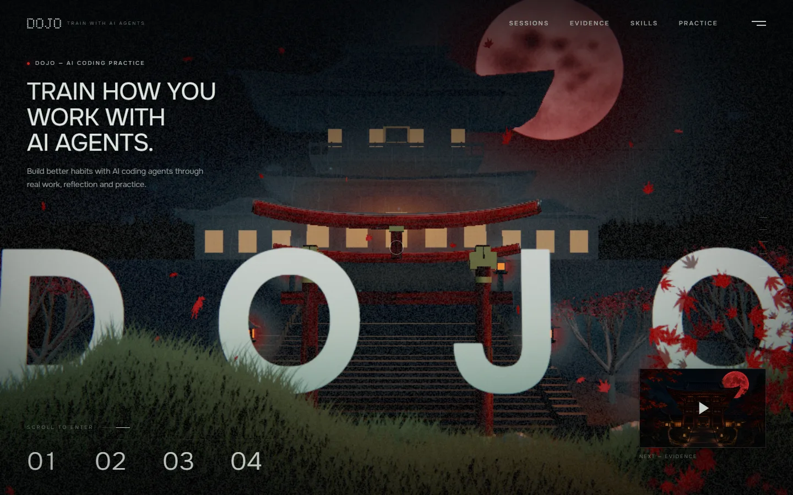
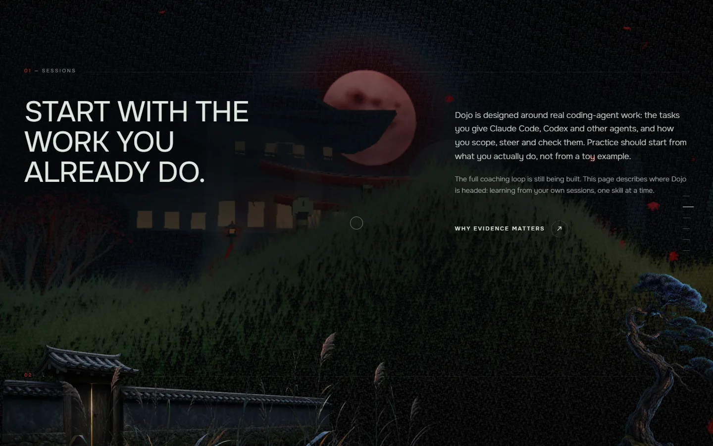
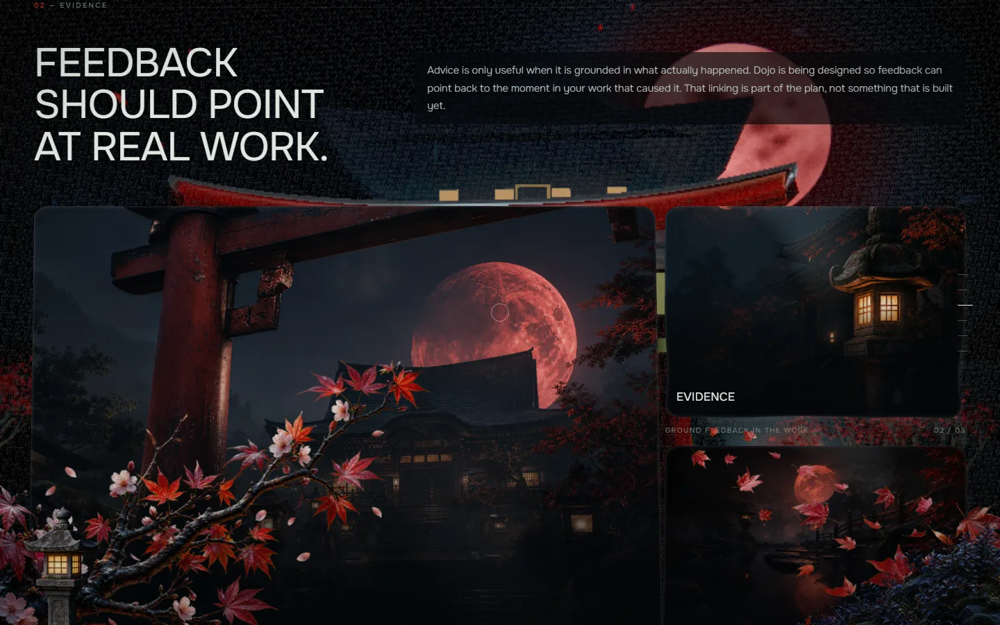
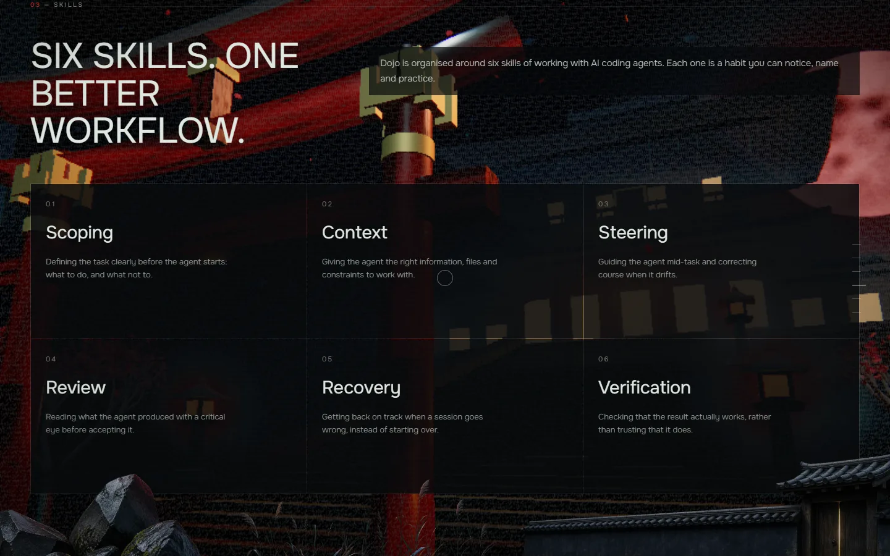
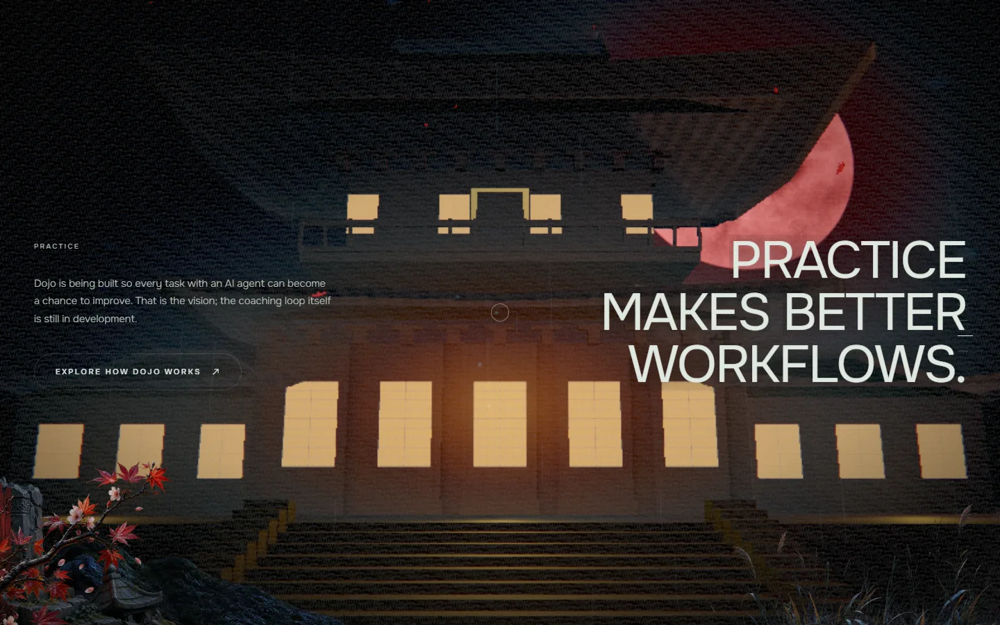
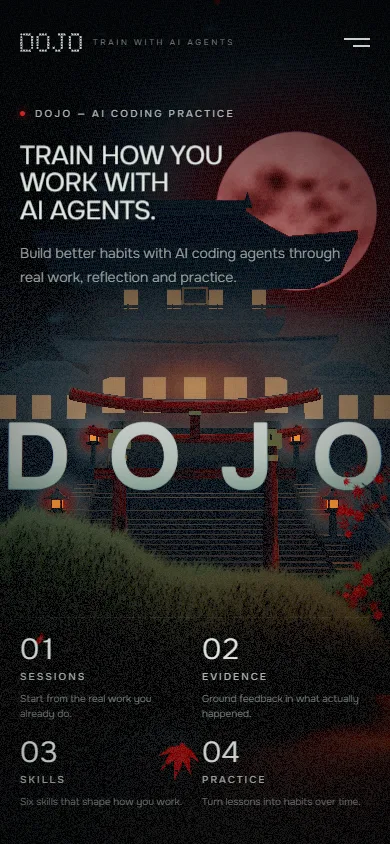
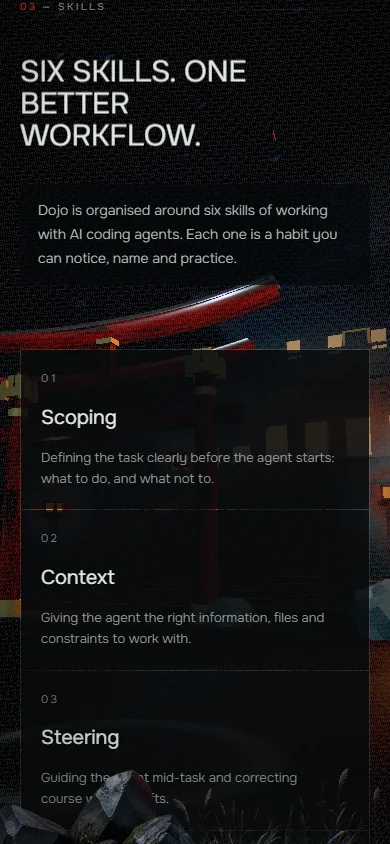

# Dojo

**Train how you work with AI coding agents.**

Dojo is a web platform being built to help developers get better at working with AI coding agents such as Claude Code and Codex. Its coaching is meant to come from review of a developer's own agent sessions, rather than from generic lessons.

> **Status: working prototype.** The public landing page, accounts, session upload, rules-based assessment with optional AI scoring, an evidence viewer, practice (scenarios, a rewrite drill and Prompting Guru) and a coaching-first dashboard are built. Progress sharing and a recorded production deployment are **not**. For the project description, journey, AI behaviour, setup and screenshots, read [`docs/SUBMISSION.md`](docs/SUBMISSION.md). See also [Project status](#project-status).



## Contents

- [Why Dojo](#why-dojo)
- [Project status](#project-status)
- [The landing page](#the-landing-page)
- [The six skills](#the-six-skills)
- [What is in this repository](#what-is-in-this-repository)
- [Quick start](#quick-start)
- [Project structure](#project-structure)
- [Documentation](#documentation)
- [Quality checks and contributing](#quality-checks-and-contributing)
- [Origin and license](#origin-and-license)

## Why Dojo

Developers now hand real work to AI coding agents, but few get feedback on _how_ they do it: how they scope a task, what context they give, when they step in, how they check the result. Generic prompt tutorials cannot see any of that.

Dojo's positioning, as recorded in [`PRODUCT.md`](PRODUCT.md):

- **Coach from what the developer actually did.** The raw material is the learner's own session logs: prompts and final answers, with secrets redacted, in the same format for Claude Code and Codex.
- **Never claim what has not been earned.** There are no customers, case studies or usage numbers yet, and the site does not invent any.
- **Treat session data as sensitive.** Keep as little as possible and keep secrets out by construction.
- **Work the same for Claude Code and Codex.** No single-agent assumptions.

How a learner's session data would reach Dojo (upload, local tooling or repository access) and its privacy model are still **undecided**. They are tracked in [`docs/HANDOFF.md`](docs/HANDOFF.md).

## Project status

| Area                                                  | Status                                                                                                                                                                                                                                                   |
| ----------------------------------------------------- | -------------------------------------------------------------------------------------------------------------------------------------------------------------------------------------------------------------------------------------------------------- |
| Public landing page (`/`)                             | **Implemented.** A scroll-driven 3D page adapted for Dojo, with copy in `messages/en.json`. See [The landing page](#the-landing-page).                                                                                                                   |
| Local session logger for Claude Code and Codex        | **Implemented.** Writes redacted digests to `.claude-logs/`, committed with the work they produced. Claude Code hooks are verified in a real session; Codex hooks are not yet verified in one. See [`docs/SESSION_LOGGING.md`](docs/SESSION_LOGGING.md). |
| Engineering foundation (CI, hooks, standards)         | **Implemented**, inherited from the template this repository started from. See [What is in this repository](#what-is-in-this-repository).                                                                                                                |
| Accounts, session upload, rules-based assessment      | **Implemented** (Supabase Auth, Prisma, `.claude-logs` digests only, rules-based scoring, PDF report). See [`docs/TEAM_SETUP.md`](docs/TEAM_SETUP.md) to run it.                                                                                         |
| Coaching-first dashboard (`/dashboard`)               | **Implemented.** Shows a next step backed by quoted evidence. A development-only sample-data mode exists for UI work; see [`docs/FRONTEND_DEV_MODE.md`](docs/FRONTEND_DEV_MODE.md).                                                                      |
| AI assessment, insights and Prompting Guru evaluation | **Implemented, optional.** Off unless `AI_ENABLED="true"` and a provider key is set; the rules engine is the fallback, and results are labelled by how they were scored. See [`docs/SUBMISSION.md`](docs/SUBMISSION.md#ai-integration).                  |
| Progress sharing                                      | **Not built.** Planning docs: [`docs/PRODUCT_STRATEGY.md`](docs/PRODUCT_STRATEGY.md), [`docs/ROADMAP.md`](docs/ROADMAP.md).                                                                                                                              |
| Deployed website                                      | **No production URL is recorded in the repository**, so none is linked here. Deployment is via Vercel; see [`docs/SUBMISSION.md`](docs/SUBMISSION.md#deployment).                                                                                        |
| Project name in code (`package.json`, `SITE.name`)    | **Not customised yet.** `package.json` is still named `template-web` and the SEO site name is still `Web template`.                                                                                                                                      |

Current state and open decisions live in [`docs/STATUS.md`](docs/STATUS.md) and [`docs/HANDOFF.md`](docs/HANDOFF.md).

## The landing page

The home page is a single scroll-driven experience: a hero, then Sessions, Evidence, Skills and Practice sections over a Three.js scene. Every screenshot below was captured from the running production build.

|                                                                                                                                                  |                                                                                                                                           |
| ------------------------------------------------------------------------------------------------------------------------------------------------ | ----------------------------------------------------------------------------------------------------------------------------------------- |
|                                          |                                   |
| **Sessions**: practice starts from the work you already do.                                                                                      | **Evidence**: feedback should point back to the moment in your work that caused it.                                                       |
|  |  |
| **Skills**: six habits of working with an agent.                                                                                                 | **Practice**: the closing section.                                                                                                        |

<p>
  
  &nbsp;
  
</p>

The page copy states plainly that the coaching loop is still being built. Technical notes (how the page is embedded, and how it was adapted from its source) are in [`docs/ARCHITECTURE.md`](docs/ARCHITECTURE.md#landing-page) and [`public/landing-pages/ADAPTATION.md`](public/landing-pages/ADAPTATION.md).

## The six skills

These are the six areas the landing page presents. They describe where Dojo is headed, not features you can use today.

| Skill            | What it means                                                                   |
| ---------------- | ------------------------------------------------------------------------------- |
| **Scoping**      | Defining the task clearly before the agent starts: what to do, and what not to. |
| **Context**      | Giving the agent the right information, files and constraints to work with.     |
| **Steering**     | Guiding the agent mid-task and correcting course when it drifts.                |
| **Review**       | Reading what the agent produced with a critical eye before accepting it.        |
| **Recovery**     | Getting back on track when a session goes wrong, instead of starting over.      |
| **Verification** | Checking that the result actually works, rather than trusting that it does.     |

## What is in this repository

Only things verified in the code are listed.

**Product**

- A localised (`next-intl`, English only today) home page that embeds the adapted landing page, with page metadata, `robots.txt`, `sitemap.xml`, `llms.txt` and `llms-full.txt` built from one page registry (`src/lib/seo/`). `llms.txt` and `llms-full.txt` are only served on an indexable production deployment.
- A session logger (`scripts/session-log.mjs`) wired through Claude Code and Codex hooks.

**Engineering foundation** (present and tested, not yet exposed in the product)

- Next.js 16 App Router, React 19 with the React Compiler, Tailwind CSS v4.
- Prisma 6 with a CI-generated migration workflow, and Supabase Auth for sessions only.
- Admin role-based access control, feature flags, a typed PostHog analytics taxonomy, Sentry error capture and a structured Pino logger (`src/lib/`, `src/server/`).
- AI usage tracking scaffolding (`src/server/lib/ai-usage/`). No AI provider SDK is installed, and the repository makes no AI calls.
- A health endpoint at `/api/health` that checks the database.
- Git hooks, a secret scanner, a standards checker (`pnpm check:standards`) and CI workflows.

## Quick start

**Prerequisites**

- Node.js `>= 22.18.0`
- pnpm `10.6.2`, the version pinned in `package.json` (`corepack enable` provides it)
- Git

**Install and run**

```bash
git clone https://github.com/faizan5002/Dojo.git
cd Dojo
pnpm install          # also sets core.hooksPath to .githooks and runs `prisma generate`
cp .env.example .env.local
pnpm dev
```

On Windows PowerShell, use `Copy-Item .env.example .env.local` for the copy step.

Open <http://localhost:3000>. The landing page needs no database connection: the only required variable is `DATABASE_URL`, which must be a valid URL, and the placeholder in `.env.example` satisfies that. Sentry, PostHog and Supabase stay off until their variables are set. Every variable is described in [`docs/ENVIRONMENT.md`](docs/ENVIRONMENT.md).

**Production build**

```bash
pnpm build
pnpm start
```

`pnpm build` needs `DATABASE_URL` set; CI uses a placeholder value, which is enough. The landing page shows a short loading screen before it unlocks, so give it a few seconds on first load. More setup detail and troubleshooting: [`docs/DEVELOPMENT.md`](docs/DEVELOPMENT.md).

## Project structure

```text
Dojo/
├── src/
│   ├── app/
│   │   ├── [locale]/            home page, layout, error and not-found pages
│   │   ├── api/health/          health endpoint
│   │   └── ...                  robots, sitemap, llms.txt, manifest, icons, share image
│   ├── features/landing/        client component that embeds the landing page
│   ├── components/              shared components and the icon wrapper (ui/icons.tsx)
│   ├── lib/                     env schema, SEO, analytics, flags, RBAC, errors, observability
│   ├── server/                  database client, API route factory, logger, AI usage tracking
│   ├── i18n/                    next-intl routing and request config
│   └── proxy.ts                 Supabase session refresh and locale routing
├── public/landing-pages/        the adapted landing page and its assets
├── messages/en.json             all user-facing copy
├── prisma/                      schema, CI-generated migrations, run-once SQL
├── scripts/                     session logger, checks, tests, landing-page generator
├── e2e/                         Playwright smoke test
├── docs/                        documentation (start at docs/README.md)
├── .github/workflows/           ci.yml, deploy-migrations.yml, claude-code-review.yml
├── .githooks/                   pre-commit, commit-msg, pre-push
├── .claude/ and .codex/         agent skills, commands and session-log hooks
├── AGENTS.md                    rules for every coding agent (CLAUDE.md imports it)
└── PRODUCT.md, DESIGN.md        product record and design conventions
```

## Documentation

The full index is [`docs/README.md`](docs/README.md). The most useful starting points:

| If you want to...                         | Read                                                                                                 |
| ----------------------------------------- | ---------------------------------------------------------------------------------------------------- |
| Understand the product and its principles | [`PRODUCT.md`](PRODUCT.md), [`docs/PROJECT_CONTEXT.md`](docs/PROJECT_CONTEXT.md)                     |
| See where the project stands              | [`docs/STATUS.md`](docs/STATUS.md), [`docs/HANDOFF.md`](docs/HANDOFF.md)                             |
| Get a local environment running           | [`docs/DEVELOPMENT.md`](docs/DEVELOPMENT.md), [`docs/ENVIRONMENT.md`](docs/ENVIRONMENT.md)           |
| Understand how the app is built           | [`docs/ARCHITECTURE.md`](docs/ARCHITECTURE.md)                                                       |
| Run or write tests                        | [`docs/TESTING.md`](docs/TESTING.md)                                                                 |
| Deploy or set up CI                       | [`docs/CI_CD_SETUP.md`](docs/CI_CD_SETUP.md), [`docs/rules/deployment.md`](docs/rules/deployment.md) |
| Contribute                                | [`CONTRIBUTING.md`](CONTRIBUTING.md)                                                                 |
| Report a security problem                 | [`SECURITY.md`](SECURITY.md)                                                                         |

## Quality checks and contributing

Run these before pushing. They are the gates the `pre-push` hook and CI run.

```bash
pnpm format:check   # Prettier
pnpm lint           # ESLint, zero warnings allowed
pnpm typecheck      # tsc --noEmit
pnpm check:env      # every process.env.X in src/ is declared
pnpm check:secrets  # secret scan over tracked files
pnpm test           # node --test: scripts and src unit tests
pnpm build          # production build
pnpm test:e2e       # Playwright (boots the app itself)
```

Commits follow Conventional Commits and carry a `Changelog:` line. Work lands through a branch and a pull request, never directly on `main`, and the git hooks are never skipped. Details: [`CONTRIBUTING.md`](CONTRIBUTING.md) and [`docs/DEVELOPMENT_WORKFLOW.md`](docs/DEVELOPMENT_WORKFLOW.md).

Dojo is built by two developers, each working with their own coding agent. Agents working in this repository must read [`AGENTS.md`](AGENTS.md) first.

## Origin and license

This repository started from the `8xsocial/template-web` Next.js template and keeps its engineering rules, CI and hooks. The landing page is adapted from the Kage landing page in the `@designcodeio/threeui` package; the adaptation and its provenance are recorded in [`public/landing-pages/ADAPTATION.md`](public/landing-pages/ADAPTATION.md).

Released under the MIT license. See [`LICENSE`](LICENSE).
