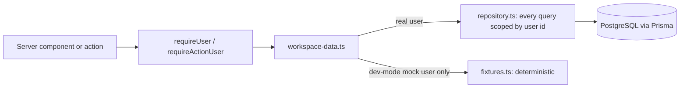
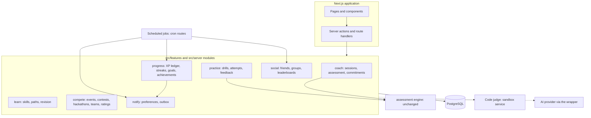
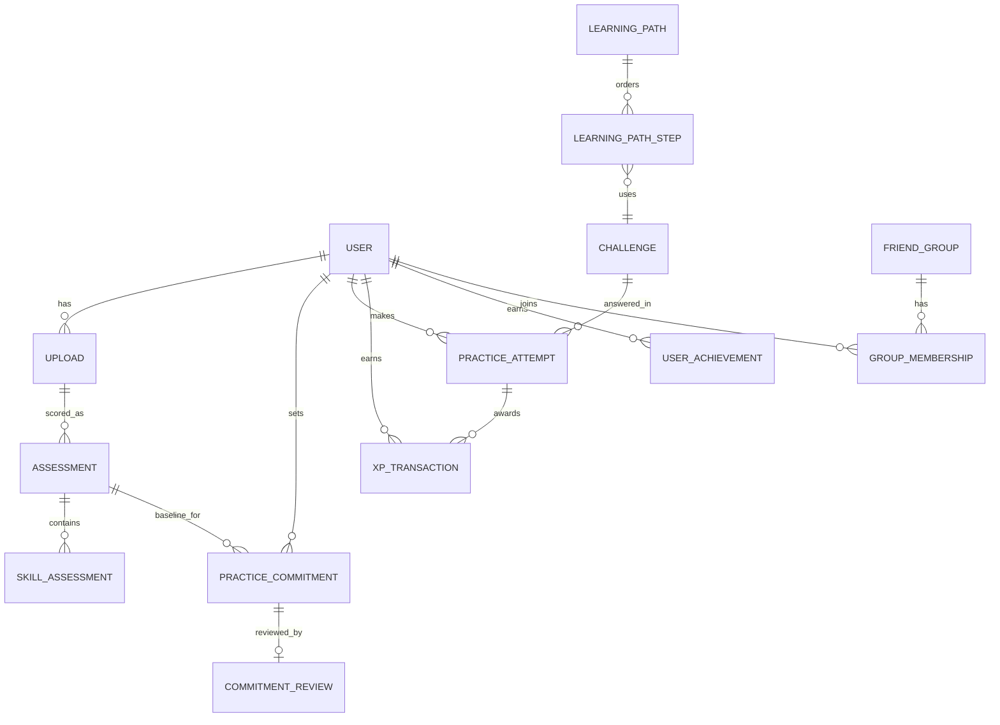
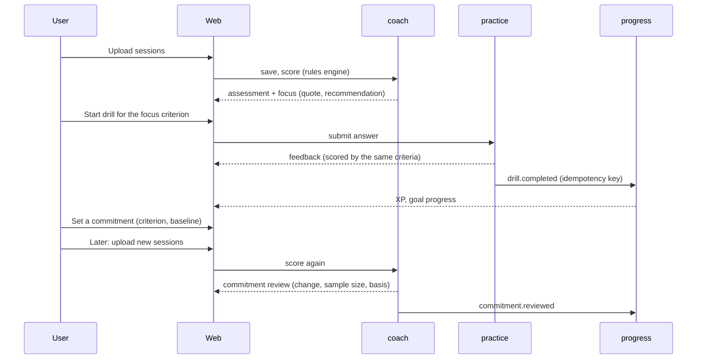
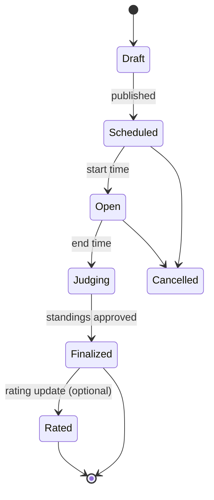

# Future architecture

Status: **proposal for founder and team review. Nothing here is built, migrated or decided.** Written 2026-11-03 in `Dojo-main` (branch `test/local-main-e2e`, base `origin/main` `56af7a4`). Companions: [`PRODUCT_STRATEGY.md`](PRODUCT_STRATEGY.md), [`ROADMAP.md`](ROADMAP.md), [`COMPETITIVE_RESEARCH.md`](COMPETITIVE_RESEARCH.md).

Tags: **[V]** verified in the repository on 2026-11-03, **[P]** proposed, **[R:Sxx]** external research (register in `COMPETITIVE_RESEARCH.md`), **[K]** general knowledge not re-verified, **[H]** hypothesis, **[D]** decision required. Feature IDs (`F-xx`) and decision IDs (`D-n`) match the strategy and roadmap.

**This document does not change code, schemas, migrations, authentication, the assessment engine or any UI**, and it proposes no migration files. Schema changes in this repository are generated by CI from a schema diff [V: `docs/rules/migrations.md`], so the entity table in section 6 describes intent only.

## 1. Executive summary

The repository is a competent, well-gated **modular monolith**: one Next.js application, Prisma over PostgreSQL, Supabase used for sign-in only, and a clean separation between pure feature logic (`src/features/**`) and server concerns (`src/server/**`) [V]. That structure is the right base. The recommendation is to **extend it, not replace it**:

1. Keep the single deployable. Add domains as new modules under `src/features/<domain>` and `src/server/<domain>`, each with a typed contract file.
2. Reuse the assessment engine unchanged. Make new features **consume its outputs** (criteria, evidence, recommendations) rather than re-implement them.
3. Introduce only the infrastructure the first milestone needs: an append-only effort ledger, a practice-attempt record, commitments, and (when notifications ship) a preference table and an outbox. Defer a job queue, code sandbox and real-time features until a phase requires them.
4. Extend the existing development seam (`workspace-data.ts` plus deterministic fixtures) so frontend work on practice, paths and gamification can proceed against typed contracts **before** the backend exists, without ever being mistaken for production behaviour.
5. Treat **abuse resistance, rate limiting and privacy retention as Phase 0 prerequisites**, because none exists today [V].

## 2. Existing architecture (verified)

### 2.1 Stack and structure [V]

| Concern        | State                                                                                                                                                                                                                        |
| -------------- | ---------------------------------------------------------------------------------------------------------------------------------------------------------------------------------------------------------------------------- |
| Runtime        | Next.js 16 (App Router, Turbopack), React 19 with the React Compiler (`panicThreshold: all_errors`), Node 22 or newer, pnpm.                                                                                                 |
| Styling        | Tailwind CSS 4, tokens in `src/app/globals.css`; the app surface re-points them in `src/app/[locale]/(app)/app.css` (ink `#05070a`, bone `#dfe7e0`, vermilion `#e0231c`, Onest light, uppercase eyebrows, hairline borders). |
| i18n           | `next-intl`, one locale (`en`). All user-facing copy in `messages/en.json`.                                                                                                                                                  |
| Data           | Prisma 6, PostgreSQL. `prisma/schema/*.prisma` (7 files), 9 applied migrations. Direct (non-PostgREST) access only; one wrapper file imports the client [V: `docs/rules/database.md`].                                       |
| Auth           | Supabase Auth for sessions only. `User.id` is the Supabase user id. Auth data and app data are separate systems.                                                                                                             |
| Observability  | Pino structured logger, Sentry (off without a DSN), PostHog with a typed event taxonomy (generic events today), Slack error alert helper.                                                                                    |
| Flags and RBAC | Typed feature-flag registry with an ordered resolution chain; an admin RBAC scaffold (`AdminMember`) with **no admin pages**.                                                                                                |
| AI             | A provider wrapper pattern and `AiUsage` cost table exist, but the wrapper is a placeholder and **no AI SDK is installed**. No AI call is made anywhere.                                                                     |
| Quality gates  | Prettier, ESLint with zero warnings, `tsc`, `check:env`, `check:secrets`, `check:standards`, `check:template`, `check:rls`, unit tests, a production build, Playwright; Git hooks and CI.                                    |

### 2.2 Application surface [V]

| Kind           | Items                                                                                                                                                                                                                                   |
| -------------- | --------------------------------------------------------------------------------------------------------------------------------------------------------------------------------------------------------------------------------------- |
| Pages          | Landing `/`; `/sign-in`, `/sign-up`, `/forgot-password`, `/reset-password`; signed-in `/dashboard`, `/sessions`, `/assessment`, `/account`; `/analytics-demo` (template reference). An `admin` layout exists with no pages.             |
| Route handlers | `GET /api/assessments/[id]/pdf` (ownership-checked PDF), `GET /api/auth/callback` (Supabase code exchange), `GET /api/health`. `robots`, `sitemap`, `llms.txt` (served only on an indexable production deployment), manifest and icons. |
| Server actions | `saveUploadAction`, `runAssessmentAction`, `deleteUploadAction` (via a Zod-validating action wrapper); auth actions (sign up, in, out, reset, update password, delete account); a feature-flag toggle action.                           |
| Middleware     | `src/proxy.ts` refreshes the Supabase session cookie, then applies locale routing.                                                                                                                                                      |
| Background     | **None.** No cron routes, queue or worker. A cron-auth helper and a route factory exist for when one is added.                                                                                                                          |

### 2.3 Data model [V]

Eleven tables, all with row-level security enabled and **no policies**; isolation is enforced in the application layer, with RLS as a deny-by-default backstop [V: `docs/rules/auth.md`; `pnpm check:rls`].

| Table                                                                                   | Purpose                                                                                                                             |
| --------------------------------------------------------------------------------------- | ----------------------------------------------------------------------------------------------------------------------------------- |
| `users`                                                                                 | One row per Supabase user (id, email, name, timestamps). Defined in `example.prisma`, a template file.                              |
| `uploads`                                                                               | One choice of files: per-file status, session, prompt and redaction counts.                                                         |
| `agent_sessions`                                                                        | One redacted coding-agent session: agent, project, start time, prompt count, and the redacted conversation as JSON `turns`.         |
| `upload_metrics`                                                                        | The free metrics of an upload, including a per-session JSON list.                                                                   |
| `assessments`                                                                           | One rubric run: version, overall score and level, strongest and weakest skill, counts, and `profile` and `recommendations` as JSON. |
| `skill_assessments`                                                                     | One of the five skills in an assessment: score, level, confidence, observations, tallies and **evidence** as JSON.                  |
| `admin_members`, `feature_flags`, `feature_flag_overrides`, `ai_usage`, `_run_once_sql` | Platform tables from the template; none holds learner data.                                                                         |

Every learner row carries `user_id` and is deleted with its owner by cascade [V]. An assessment is an immutable snapshot, so history keeps the scores and rubric version it was made with [V]. Evidence ids are unique **within an assessment only** (the same id string can occur in two assessments) [V: verified while testing the dashboard], so any new feature that refers to a quote must reference **assessment id plus evidence id**.

### 2.4 Assessment engine [V]

- **Pure TypeScript** under `src/features/assessment/` (about 1,470 lines): `assess.ts` orchestrates `skills/{clarity,planning,verification,iteration,scope}.ts` over `signals.ts` (text pattern detection), `observation.ts`, `interactions.ts`, `profile.ts`, `recommendations.ts`, `redact.ts`. Rubric version `rules-1.0`.
- **Five skills**, each with named strength and opportunity **criteria** (for example `statesGoal`, `givesContext`, `statesConstraints`, `definesDone`; `asksForPlan`; `asksForVerification`; `specificFeedback`; `namesTargets`, `broadRequest`). A skill is scored only above a minimum number of observations (for example 3 requests for prompt clarity, 2 larger builds for planning); the overall score needs at least three scorable skills; recommendations cover skills scoring below 80, at most three.
- **Deterministic, free, private and testable.** It reads wording, not intent, and is English-only [V: `docs/DECISIONS.md`].
- **Implication for expansion:** the criteria are already a machine-readable taxonomy of "habits". Drills, paths, commitments and revision can all be keyed on a **criterion id**. No new scoring engine is needed for them [P].

### 2.5 Intake and processing [V]

The browser reads `.md` files, parses them (the repo logger's format, or the original guide's extractor format), redacts credential-shaped strings, and sends only the redacted sessions. The server validates and redacts again, recomputes the metrics, and stores the upload, sessions and metrics in one transaction. Raw files are never stored. **Intake does not accept raw agent transcripts**, and the digests come from hooks wired into a developer's own repository [V: `docs/SESSION_LOGGING.md`]. This is the single largest activation barrier for a new user [P: F-I1].

### 2.6 Data-access pattern and the development seam [V]

- `getCurrentUser` is purely real. `getAppUser` adds a labelled mock user **only** when `NODE_ENV !== "production"` and `DOJO_DEV_FRONTEND_MODE` is exactly `true`; production builds, starts and PDF requests were verified to ignore it.
- `workspace-data.ts` is the one place pages read a workspace. A real user always reads the repository; fixtures are served only to the mock user.
- The dashboard's `buildDashboard` is a **pure view model** over these reads, with unit tests, which is the pattern to copy.

### 2.7 UI foundation [V]

`src/components/ui/` has only `badge`, `button`, `card`, `input`, `label`, `textarea`, `toast`, `toaster` and an `icons` wrapper; most app screens use CSS classes from `app.css` (`app-pill`, `app-eyebrow`, `app-card`, `app-nav-link`, `app-side-link`) and Tailwind utilities. Components are server-rendered by default with small client islands. A signed-in shell (sidebar, header, skip link, named landmarks) wraps the app pages. There is **no data-table, tabs, dialog, chart or form-library component**; the two charts are hand-written SVG.

### 2.8 Testing architecture [V]

| Layer   | State                                                                                                                                                                                                                                                                                  |
| ------- | -------------------------------------------------------------------------------------------------------------------------------------------------------------------------------------------------------------------------------------------------------------------------------------- |
| Unit    | `node --test` over `scripts/*.test.mjs` and `src/**/*.test.mts`: 31 files, **343 tests**, 342 passing and 1 skipped (the Windows executable-bit check) on the last full run. Database-backed tests run only with `TEST_DATABASE_URL` set (a separate local database was used).         |
| Browser | Playwright, 51 specs: 24 run with real Supabase and PostgreSQL (auth, sessions, assessment, PDF, dashboard real-account states, smoke); 27 are dev-mode fixture specs that skip unless the flag is on. All passed in the last runs in both configurations.                             |
| CI      | Jobs: commit-message, check (format, lint, types, env, secrets, standards, unit), AI-model registry, build, e2e, migrations (replays migrations and runs the RLS check). **CI supplies no Supabase credentials, so the auth-backed Playwright specs skip in CI** and run only locally. |
| Gap     | No performance, load, accessibility-audit or visual-regression automation in CI; accessibility is covered by targeted Playwright assertions on the dashboard only.                                                                                                                     |

### 2.9 Limitations and technical debt (verified)

| Item                                                                                                                                                       | Impact on the expansion                                                                                 |
| ---------------------------------------------------------------------------------------------------------------------------------------------------------- | ------------------------------------------------------------------------------------------------------- |
| Package name is `template-web` and `SITE.name` is `Web template`; `template-setup` has not been run [V: `docs/HANDOFF.md`, `package.json`]                 | Branding, SEO and docs not product-ready.                                                               |
| `README.md` and `docs/STATUS.md` on `main` still say accounts and upload are "not built", which the code contradicts (a docs PR is open on another branch) | New contributors get a false picture; fix in Phase 0.                                                   |
| Landing page lists **six** skills; the rubric scores **five** with different names                                                                         | A vocabulary decision (D-4) blocks learning-path structure.                                             |
| **No rate limiting** anywhere in `src`                                                                                                                     | Any public write path (upload, drill submit, later contests) is open to abuse. Phase 0.                 |
| **No background jobs, cron routes, queue, or outbound email/push** (only Supabase auth mail)                                                               | Notifications, leaderboards, streak rollups and contests all need one. Phase 2 prerequisite.            |
| AI wrapper is a placeholder; no SDK, no consent model                                                                                                      | LLM coaching is a decision (D-5), not a switch.                                                         |
| `listUploads` and `listAssessments` are unpaginated; sessions and evidence are JSON blobs                                                                  | Fine at small scale; revisit before leaderboards, cohorts or long histories.                            |
| `User` lives in `example.prisma` (a template file)                                                                                                         | Profile fields (display name, goal, timezone, visibility) need a proper home; moving it is a migration. |
| Session logs are tracked in the repository by owner policy; redaction misses names, private code and paths [V: `docs/DECISIONS.md`]                        | Privacy posture must be settled before any social or public surface.                                    |
| Dev frontend mode is documented as **temporary** [V: `docs/FRONTEND_DEV_MODE.md`]                                                                          | Decide to retire it or evolve it into a fixtures-first prototype mode (section 8).                      |
| Single locale, English-only rules engine                                                                                                                   | Limits any non-English audience and any contest involving prompts in other languages.                   |
| Playwright auth specs do not run in CI                                                                                                                     | Regressions in the core flows are caught only locally; consider a dedicated test Supabase project.      |

## 3. Architectural principles for the expansion [P]

1. **Extend the monolith.** One deployable, one database, modules with explicit contracts. Do not split services at this team size.
2. **Evidence-first.** Anything the product says about a user's skill must trace to stored evidence or a defined, tested rule.
3. **Contract before implementation.** Each domain defines its types (Zod schemas) in a contract file that frontend and backend both depend on.
4. **Append-only where money-like.** Effort (XP) is a ledger of immutable entries; balances and streaks are **derived**, never edited.
5. **Derived over stored.** Prefer computing streaks, levels and standings from events, and cache only when measured to be slow.
6. **Idempotent events.** Every event that can award something carries an idempotency key so retries cannot double-award.
7. **Opt-in social surface.** No learner data is visible to another user unless the owner opted in; opt-out is one action.
8. **Least data.** Do not store what a feature does not need; keep the "no raw files" rule.
9. **Fixtures first for UI.** Frontend prototypes run against deterministic fixtures behind the existing seam and are labelled as such.
10. **Gate by flag.** New domains ship behind feature flags using the existing registry.

## 4. Target architecture [P]

**Layering rules [P].** (a) `src/features/<domain>/` holds pure logic, types, Zod contracts and UI. (b) `src/server/<domain>/` holds repositories and server actions. (c) Only `repository.ts`-style files call Prisma, and every learner query is scoped by user id, as today [V]. (d) Pages read through a seam like `workspace-data.ts` so fixtures can stand in during development. (e) Domains talk through exported functions and domain events, never through each other's tables.

### Domain events (conceptual)

| Event                                    | Emitted by    | Consumed by                                       |
| ---------------------------------------- | ------------- | ------------------------------------------------- |
| `assessment.completed`                   | coach         | practice (recommend drills), progress (XP), learn |
| `commitment.set` / `commitment.reviewed` | coach         | progress, notify                                  |
| `drill.attempted` / `drill.completed`    | practice      | progress (XP, streak), learn (skill progress)     |
| `xp.awarded`                             | progress      | achievements, leaderboards                        |
| `week.rolled`                            | scheduled job | progress (streak), notify (weekly summary)        |
| `achievement.earned`                     | progress      | notify                                            |
| `contest.opened` / `contest.closed`      | compete       | notify, leaderboards, ratings                     |

## 5. Responsibilities and boundaries

### 5.1 Frontend responsibilities [P]

- Pages, navigation and the responsive shell: Home, Coach, Practice, Learn, Compete, You (`PRODUCT_STRATEGY.md` section 7).
- Component architecture: promote repeated patterns from `app.css` into components (list row, stat, progress rail, drill workspace, standings table, achievement tile), keeping server rendering by default.
- Interaction states: loading, empty, error, success and **honest uncertainty** states for every new surface, as the dashboard already models [V].
- Responsive and accessible behaviour: a bottom tab bar on mobile, 44 px targets, one focus ring, named landmarks, reduced-motion respect [V: already enforced on the dashboard].
- Practice and learning interfaces; gamification interfaces (XP, streak, goal, achievements) with calm, non-coercive presentation; profile and leaderboard interfaces; notification-preference UI.
- **Frontend prototypes against deterministic fixtures**, through the same seam as production reads (section 8).

### 5.2 Backend responsibilities [P]

- Persistence of progress, attempts, commitments, goals, preferences and (later) events and teams.
- **XP and reward calculation**, **streak tracking**, **achievement eligibility**: computed on the server from events, never trusted from the client.
- **Challenge and drill evaluation**: scoring a drill answer with the existing rules engine (server-side), and later any judge.
- **Leaderboard and standings calculation**, contest lifecycle, rating updates.
- **Notification scheduling and delivery**, honouring preferences.
- **Abuse prevention, rate limits and resource controls**; **data retention and privacy enforcement**.

### 5.3 Ownership matrix

The team has two developers working with agents [V: `docs/DEVELOPMENT_WORKFLOW.md`]. Names are not assigned here **[D-11]**; the matrix assigns **kinds of work** so nothing is silently dumped on the frontend.

| Capability                      | Frontend owns                     | Backend owns                                          | Shared contract (both must agree before building)                        |
| ------------------------------- | --------------------------------- | ----------------------------------------------------- | ------------------------------------------------------------------------ |
| Drills                          | Drill workspace, feedback display | Drill storage, evaluation, attempt record             | `DrillDefinition`, `DrillAttempt`, `DrillFeedback`                       |
| Commitments                     | Set and review UI                 | Persistence, review computation against assessments   | `Commitment`, `CommitmentReview`                                         |
| XP, streak, goals               | Progress UI, celebration          | Ledger, rollup, streak and goal logic                 | `XpEntry`, `StreakState`, `GoalState`                                    |
| Achievements                    | Presentation                      | Eligibility rules and award                           | `AchievementDefinition`, `UserAchievement`                               |
| Skill map and paths             | Map and path views                | Path definitions, progress                            | `SkillProgress`, `LearningPath`, `PathProgress`                          |
| Leaderboards and groups         | Tables, join and leave flows      | Membership, standings computation, privacy filters    | `Standing`, `GroupMembership`, with the **metric named in the contract** |
| Notifications                   | Preferences UI                    | Preference storage, scheduling, delivery, unsubscribe | `NotificationPreference`, `NotificationEvent`                            |
| Contests and hackathons (later) | Brief, timer, standings views     | Lifecycle, submission handling, integrity, ratings    | `Contest`, `Submission`, `Standing`, `Team`                              |
| Privacy and retention           | Controls and copy                 | Deletion, retention jobs, export                      | `PrivacySettings`, deletion cascade list                                 |

**Rule:** a feature is not "frontend-complete" until its contract has a backend owner and an agreed persistence plan. The existing pattern of a dev-mode seam must not become a way to ship pages whose data nobody owns.

## 6. Domain model

Intent only, no schema work. "Exists" is relative to the repository today [V].

| Entity                                    | Purpose                                                                                    | Key relationships                                    | Exists today?                                                | New persistence?   | Likely owning module |
| ----------------------------------------- | ------------------------------------------------------------------------------------------ | ---------------------------------------------------- | ------------------------------------------------------------ | ------------------ | -------------------- |
| **UserProfile**                           | Display name, goal, timezone, visibility and notification-adjacent settings                | 1:1 `User`                                           | **Partly**: `users` has id, email, name                      | Yes (extend)       | `account`            |
| **Skill**                                 | The five rubric skills, plus the vocabulary decision D-4                                   | Has criteria; referenced by paths and drills         | **Yes, in code** (`rubric.ts`), not in the database          | No (static)        | `coach`              |
| **SkillProgress**                         | A user's level and trend per skill, derived from assessments and drills                    | `User`, `Skill`, `Assessment`                        | **Partly**: `skill_assessments` per run; no rollup           | Optional cache     | `learn`              |
| **LearningPath**                          | A bounded, ordered sequence of drills and readings for one skill                           | Has many `LearningPathStep`                          | No                                                           | Static or yes      | `learn`              |
| **LearningPathStep**                      | One step: a drill, a reading or a milestone, with prerequisites                            | `LearningPath`, `Challenge`                          | No                                                           | Static or yes      | `learn`              |
| **Challenge** (drill)                     | An authored exercise keyed to a criterion, with a worked example                           | Skill, criterion                                     | No                                                           | Yes (or static)    | `practice`           |
| **ChallengeSubmission / PracticeAttempt** | One user answer to a drill and its feedback                                                | `User`, `Challenge`; optionally `Assessment` signals | No                                                           | **Yes**            | `practice`           |
| **Contest**                               | A timed event with a brief, window and scoring rule                                        | Many `ContestParticipant`                            | No                                                           | Yes                | `compete`            |
| **ContestParticipant**                    | A user or team entered in a contest                                                        | `Contest`, `User`/`Team`                             | No                                                           | Yes                | `compete`            |
| **ContestStanding**                       | Ranked results of a contest, with the metric stated                                        | `Contest`, participants                              | No                                                           | Yes (snapshot)     | `compete`            |
| **RatingHistory**                         | Rating changes after rated contests                                                        | `User`, `Contest`                                    | No                                                           | Yes                | `compete`            |
| **Leaderboard**                           | A named ranking over a metric and scope (group, cohort, event)                             | Entries per user                                     | No                                                           | Snapshot           | `social`             |
| **Achievement**                           | Definition of a milestone and its eligibility rule                                         | Many `UserAchievement`                               | No                                                           | Static definitions | `progress`           |
| **UserAchievement**                       | An achievement a user has earned, with the evidence that earned it                         | `User`, `Achievement`                                | No                                                           | **Yes**            | `progress`           |
| **XPTransaction**                         | An immutable effort entry (amount, reason, source id, idempotency key)                     | `User`; source is an attempt or review               | No                                                           | **Yes (ledger)**   | `progress`           |
| **UserStreak**                            | Derived weekly-rhythm state; stored only as a cache of the ledger and events               | `User`                                               | No                                                           | Cache only         | `progress`           |
| **DailyGoal** (weekly goal)               | A user-chosen target and its progress                                                      | `User`                                               | No                                                           | Yes                | `progress`           |
| **Quest / QuestProgress**                 | Time-boxed missions and per-user progress                                                  | `User`                                               | No                                                           | Later              | `progress`           |
| **Reward**                                | A non-monetary recognition (title, cosmetic). **No currency proposed** (F-G7 is "not now") | `UserAchievement`                                    | No                                                           | Later              | `progress`           |
| **NotificationPreference**                | Channels, frequency and times a user opted into                                            | `User`                                               | No                                                           | **Yes**            | `notify`             |
| **Hackathon**                             | A team-based event with a brief, schedule and judging                                      | Teams, submissions                                   | No                                                           | Later              | `compete`            |
| **Team / TeamMembership**                 | A set of users entered together                                                            | `User`, `Hackathon`/`Contest`                        | No                                                           | Later              | `compete`            |
| **Session**                               | One redacted agent session                                                                 | `Upload`, `User`                                     | **Yes** (`agent_sessions`)                                   | No                 | `coach`              |
| **Assessment**                            | One rubric snapshot with skill rows and evidence                                           | `Upload`, `User`, `SkillAssessment`                  | **Yes**                                                      | No                 | `coach`              |
| **CoachingRecommendation**                | A recommendation tied to a criterion and an evidence quote                                 | `Assessment`, evidence                               | **Partly**: stored as JSON inside `assessments`, not as rows | Optional (rows)    | `coach`              |
| **PracticeCommitment** (new)              | A habit the user commits to apply in the next real session, with its baseline count        | `User`, criterion, `Assessment` baseline             | No                                                           | **Yes**            | `coach`              |
| **CommitmentReview** (new)                | The outcome comparison against a later assessment, with the sample size                    | `PracticeCommitment`, `Assessment`                   | No                                                           | **Yes**            | `coach`              |
| **Friendship / Group** (new)              | Opt-in social links and private groups                                                     | `User`                                               | No                                                           | **Yes**            | `social`             |

Entities drawn solid in the first five lines **exist** [V]; the rest are proposed.

## 7. Event flows and lifecycles

### 7.1 The improvement loop [P]

### 7.2 Contest lifecycle [P, Phase 4, option]

Integrity checks run during `Judging` and a finalized standing is immutable, with corrections as new entries (**[D-10]**: whether any rating is allowed before scoring is robust to gaming).

### 7.3 Notification pipeline [P]

User preference, then a scheduled job reads due items, writes to an **outbox** with an idempotency key, a sender delivers and records the result; every message has a one-tap unsubscribe that updates the preference immediately. Needs D-7 (provider, domain, consent text).

## 8. Cross-cutting design [P]

### 8.1 XP ledger, streaks and goals

- **XP is a ledger.** `XPTransaction` rows are append-only; each carries a unique idempotency key (for example `drill-attempt:<id>`), so a retried request cannot award twice. A user's XP is a sum, never an editable number.
- **XP and proficiency stay separate.** XP records effort; proficiency comes only from assessments. This is the reason a high XP can never be mistaken for high skill.
- **Streak is derived.** Weekly rhythm is computed from meaningful-session events and the user's timezone; the stored `UserStreak` is a cache that can be rebuilt. A missed week creates **no loss**; the model keeps a best value and a current run that can resume.
- **Meaningful session is an event type**, defined once (strategy section 4) and emitted by the server, not inferred from page views.

### 8.2 Leaderboards

Computed by a scheduled job into **snapshots**, not live queries over events, with the **metric named in the data**. Visibility is filtered by group membership and the user's opt-in. No global board is proposed (strategy F-S05); effort-based group boards come first (F-S02).

### 8.3 Notifications

`NotificationPreference` (channel, frequency, time, mute) plus an outbox. Defaults are off or weekly. Messages are informational, never guilt-framed. No push channel is proposed before email proves useful.

### 8.4 Jobs

A scheduled-job mechanism does not exist [V]. Start with HTTP cron routes under `src/app/api/cron/**` guarded by the existing cron-auth check [V], which suits the weekly rollup and weekly summary. Adopt a queue only when work cannot finish in a request **[D-12]**. This is an unmeasured choice; the hosting platform's job limits were not researched here **[K]**.

### 8.5 Anti-cheat, abuse prevention and resource controls

| Surface                        | Concern                                                                           | Proposed control                                                                                                             |
| ------------------------------ | --------------------------------------------------------------------------------- | ---------------------------------------------------------------------------------------------------------------------------- |
| All write endpoints            | No rate limiting exists [V]                                                       | Per-user and per-IP limits at the action and route layer; size caps already exist for uploads (20 MB, 200 files) [V].        |
| Drill scoring                  | Keyword stuffing to satisfy the rules engine                                      | Score on several signals; cap repeat attempts' XP; show feedback that explains why; treat drill XP as effort, never as rank. |
| Assessment as a ranking metric | The rubric reads wording and is gameable [V: `docs/DECISIONS.md`]                 | Do not rank on assessment scores until an integrity design exists (**D-10**).                                                |
| Fabricated sessions            | A user uploads edited or synthetic logs to inflate scores                         | Avoid ranking on uploads; for any competitive use require a provenance check or in-platform capture **[H]**.                 |
| Contests (later)               | Collusion, shared answers, scorer tuning; LLM-era cheating was **not researched** | An explicit integrity design before the first contest; start with unrated practice events.                                   |
| Code execution (option, later) | Sandbox escape, resource exhaustion                                               | Isolated sandbox with CPU, memory, time and network limits; buy or self-host decision **D-6**; not designed here.            |
| XP farming                     | Repeating trivial drills                                                          | Daily or weekly XP caps per drill; diminishing returns on repeats; XP only for completed feedback.                           |

### 8.6 Privacy, retention and deletion

Keep the verified rules: no raw files, redaction on client and server, every row deletable by cascade, account deletion removes sign-in as well [V]. Add: a **retention period** for stored conversation text **[D-13]**; no public exposure of quotes by default; an explicit consent step before any AI provider sees prompts (**D-5**); a documented list of what each new table stores and how it is deleted. Opt-in social data is deleted with the owner like all other rows.

### 8.7 AI provider integration

Use the existing wrapper and the `AiUsage` cost table [V]; add models to the registry first, as the repository rule requires. AI explanations or an LLM judge are **additive**: the rules engine remains the scored source of truth and the LLM may add explanation or a second opinion, clearly labelled. No call before D-5.

### 8.8 Code execution (option)

If F-P6 is approved, run untrusted code in an isolated sandbox service, separate from the web process, with submissions, test cases, resource limits and verdicts as its own module **[D-6]**. Providers and self-hosting options were **not researched** here **[K]**. The roadmap keeps this behind Phase 3.

### 8.9 Rollout and measurement

Ship each domain behind a feature flag from the existing registry [V]. Extend the typed analytics taxonomy with domain events (drill started and completed, commitment set and reviewed, meaningful session) rather than generic clicks. Keep **no** personal text in events [V: `docs/rules/analytics.md`].

## 9. Frontend prototypes with deterministic fixtures [P]

Extend the pattern that already exists [V: `workspace-data.ts`, `src/features/dev-frontend/`]:

1. **Contract first.** Each new domain adds a Zod contract file and fixtures that produce values in exactly that shape.
2. **One seam per domain.** A `practice-data.ts`, `progress-data.ts` and so on, each choosing between a real repository and fixtures.
3. **Labelled and gated.** Prototype pages show a visible "sample data" banner (as dev mode does [V]) and are reachable only with the dev flag. They are **never linked from production navigation** and never write to the database.
4. **Scenarios.** Fixtures should cover each state (empty, in progress, complete, error), so the same screenshots and tests are reproducible.
5. **Retire or promote.** When a backend exists for a contract, the seam switches to the repository and the fixtures remain for tests. **[D-14]**: keep dev mode permanently as a fixtures-first prototype mode, or remove it.

**Hazard to avoid:** a prototype that looks like production. Banners, flags and the "writes are refused" behaviour [V] are the guard; any new prototype must carry the same three.

## 10. Phase-to-architecture mapping

| Phase                  | New architecture                                                                                          |
| ---------------------- | --------------------------------------------------------------------------------------------------------- |
| 0 Stabilise and intake | Rate limits; docs sync; template rename; skill vocabulary; intake path; instrumentation; retention policy |
| 1 Improvement loop     | `practice` and `coach` extensions: drills, attempts, commitments, reviews; skill map; fixtures seams      |
| 2 Progression          | `progress` (ledger, goals, streak, achievements), `notify`, first scheduled jobs, profile fields          |
| 3 Social               | `social` (friends, groups, effort leaderboards), privacy filters, snapshot jobs                           |
| 4 Competition          | `compete` (events, contests, teams), integrity design, optional judge                                     |
| 5 Personalisation      | AI provider layer, adaptive paths, LLM judge (all optional and consent-gated)                             |

## 11. Risks

| Risk                                              | Mitigation                                                                                    |
| ------------------------------------------------- | --------------------------------------------------------------------------------------------- |
| New domains bloat one codebase                    | Module boundaries and lint rules on cross-domain imports; extract only on measured need       |
| Ledger or streak bugs erode trust                 | Idempotency keys, derived state, rebuild-from-events tests, no editable balances              |
| JSON-blob storage blocks analytics and cohorts    | Add relational rows for recommendations and criterion observations when per-habit trends ship |
| Contest or ranking scope outruns integrity design | Phase gate on D-10 and D-6                                                                    |
| CI does not exercise auth flows                   | Provision a dedicated test Supabase project or document the local-only gate                   |
| Fixtures mistaken for production                  | Banner, flag, refusal of writes, no production links                                          |

## 12. Decisions requiring approval

| #    | Decision                                                                               |
| ---- | -------------------------------------------------------------------------------------- |
| D-2  | Intake path (logger installer, raw transcript import, or both) and logger distribution |
| D-4  | One skill vocabulary                                                                   |
| D-5  | AI provider, consent model and cost policy                                             |
| D-6  | Code execution: build, buy or skip                                                     |
| D-7  | Notification provider and consent                                                      |
| D-10 | Whether any ranking is allowed before scoring resists gaming                           |
| D-11 | Named ownership of backend and frontend modules                                        |
| D-12 | Scheduled jobs: cron routes only, or a queue                                           |
| D-13 | Retention period for stored conversation text                                          |
| D-14 | Fate of the development frontend mode                                                  |

## 13. Open questions

- What is the expected scale (users, sessions) over the next year? None is stated or measured, so no capacity sizing is proposed.
- Is the rules engine's English-only limit acceptable for the first audience?
- Should the hosting platform's cron and background limits be researched before D-12?
- Which of the open `docs/HANDOFF.md` items (indexing, invitation, logger defaults) remain unanswered?

This document is a plan only. It authorises no migration, dependency, code change or deployment.
