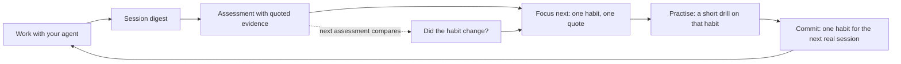
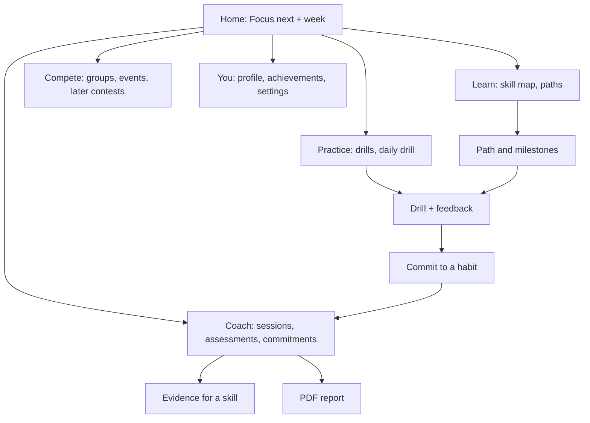

# Product strategy

Status: **proposal for founder and team review. Nothing here is built or decided.** Written 2026-11-03 in `Dojo-main` (branch `test/local-main-e2e`, base `origin/main` `56af7a4`). Companions: [`COMPETITIVE_RESEARCH.md`](COMPETITIVE_RESEARCH.md) (sources and evidence), [`FUTURE_ARCHITECTURE.md`](FUTURE_ARCHITECTURE.md) (how it would be built), [`ROADMAP.md`](ROADMAP.md) (in what order).

Tags used throughout: **[V]** verified in the repository today, **[P]** proposed, **[R:Sxx]** external research (register in `COMPETITIVE_RESEARCH.md`), **[K]** general knowledge not re-verified, **[H]** hypothesis to test, **[D]** decision required. Feature IDs (`F-xx`) are shared with the roadmap.

## 1. Executive summary

**What Dojo is today [V].** A Next.js web app with accounts (Supabase Auth), a saved workspace in PostgreSQL, and one genuinely differentiated capability: it reads a developer's own coding-agent session digests, scores five workflow skills with a deterministic rules engine (`rules-1.0`), and shows the result with **exact quotes from the developer's own prompts** as evidence. The dashboard now leads with a "Focus next" block (weakest skill, a quote, one recommendation, one action). There is a PDF report, an upload flow, and a development-only frontend mode. **Nothing else in the vision exists**: no practice content, no learning paths, no XP, streaks, notifications, contests or leaderboards. A search of `src` finds no implementation of those concepts; the few word matches are unrelated (for example the rubric criterion `challengesClaims`).

**Recommendation.** Do not build a coding-practice site with an AI feature attached. Build the **improvement loop** that only Dojo can offer, and let familiar learning-platform patterns serve that loop:

> Work with your agent, Dojo finds the habit most worth changing and shows the lines that prove it, you practise that one habit, you commit to using it in real work, and the next assessment shows whether it changed.

The loop is the product. Practice, paths, streaks, and later social and contests are ways of making the loop easier to start, easier to repeat and more motivating. Competitive programming is a crowded, expensive ecosystem (code execution, anti-cheat, rating infrastructure) [R:S01, S04, S09, S12], and Dojo has no edge there. Its edge is that it can measure improvement on **real work**.

**Smallest compelling version [P].** The "Improvement Loop v1" in section 11: faster first value, a small set of rubric-aligned drills, a practice commitment, and a before/after comparison on real sessions. No code judge, no contests, no leagues, no virtual currency.

**Two risks to confront first.** (1) Getting session data in is hard: intake only accepts the digest format written by this repository's own logger [V], so a typical developer cannot try Dojo without installing it. (2) The rubric reads wording, so a public ranking built on it would invite gaming [V: `docs/DECISIONS.md`, "Limits"]. Section 8 and the roadmap sequence the work around both.

**Recommended next milestone: M1 "Make the loop real"** (roadmap Phase 0 and the first half of Phase 1): decide and ship an easier intake path, add a sample-session first run, ship the first drills and commitments, and add activation measurement. See section 13.

## 2. Existing verified functionality

Everything in this table was checked in the repository on 2026-11-03. Full architecture is in `FUTURE_ARCHITECTURE.md` section 2.

| Capability        | State [V]                                                                                                                                                                                                                                                                                                                                                         |
| ----------------- | ----------------------------------------------------------------------------------------------------------------------------------------------------------------------------------------------------------------------------------------------------------------------------------------------------------------------------------------------------------------- |
| Landing page      | Adapted Kage page in an iframe. It lists **six** skills (Scoping, Context, Steering, Review, Recovery, Verification) while the product scores **five** (Prompt clarity, Planning before coding, Verifying AI output, Iteration quality, Scope control). A naming mismatch to resolve.                                                                             |
| Accounts          | Supabase Auth with email and password; sign-in, sign-up, password reset, an account page with data and account deletion. Whether sign-up requires email confirmation is a setting of the Supabase project, not of this code, which supports both.                                                                                                                 |
| Session intake    | Browser parses and redacts `.md` digests from `.claude-logs/` (up to 200 files of 5 MB). Only the redacted sessions are sent; the raw file is never stored. Accepts the repo logger's format and the original guide's extractor format; not raw agent transcripts.                                                                                                |
| Metrics           | Free metrics per upload (prompt length, paste ratio, gaps, code blocks, file paths, URLs).                                                                                                                                                                                                                                                                        |
| Assessment        | Five skills, 0 to 100, four levels (Needs improvement, Developing from 40, Proficient from 60, Strong from 80), evidence confidence (strong, limited, insufficient), an overall score needing at least three scorable skills, and up to three recommendations built from the weakest scorable skills with a quotable gap. Rules-based, English-only, no AI model. |
| Evidence          | Exact slices of the user's redacted prompts, with session, prompt number and offsets; labelled rewrite templates around the user's own first sentence.                                                                                                                                                                                                            |
| History           | Every assessment is a saved snapshot; history list with search, filter and sort; earlier-versus-latest comparison on the dashboard.                                                                                                                                                                                                                               |
| Reports           | Server-rendered PDF per assessment, ownership-checked.                                                                                                                                                                                                                                                                                                            |
| Dashboard         | "Focus next" block, performance with evidence basis, five-skill overview, progress, recent sessions, and four real-account states (empty, uploaded, insufficient evidence, ready).                                                                                                                                                                                |
| Dev frontend mode | A development-only mock user and deterministic fixtures, impossible to enable in a production build (verified by build and probes).                                                                                                                                                                                                                               |
| Platform          | Next.js 16, React 19, Tailwind 4, Prisma 6, next-intl (English only), PostHog and Sentry hooks (off without keys), feature-flag registry, admin RBAC scaffold with no admin pages.                                                                                                                                                                                |

**Not present [V]:** practice content, challenges, code execution, learning paths, XP, streaks, achievements, notifications (only a Slack alert helper for server errors), email sending beyond Supabase auth mail, contests, leaderboards, friends, teams, public profiles, rate limiting, background jobs or cron routes, an AI provider SDK (the wrapper is a placeholder).

## 3. Vision and the differentiator

**Vision [P].** A familiar, motivating developer-learning platform whose defining feature is that it understands how you actually work with coding agents and turns evidence of your weaknesses into practice and progress.

**What makes Dojo different [V, and the part to protect].**

1. **Evidence, not opinion.** Every score and recommendation points to a quote from the user's own session. A skill with too little evidence is left unscored rather than scored low [V: `docs/DECISIONS.md`].
2. **Honesty about uncertainty.** Limited evidence is labelled, comparisons on thin evidence are muted [V: dashboard work].
3. **Privacy by construction.** Raw logs are not stored; only redacted sessions are [V].

**Product principles [P].**

1. **Coach from real work.** Prefer evidence from the user's own sessions to generic lessons.
2. **One next step.** Always make the single best next action obvious.
3. **Measure improvement on real work.** Practice counts when it changes how the user works, not when it is completed.
4. **Familiar shell, distinct core.** Use recognisable navigation and progress patterns (Jakob's Law); keep the coaching loop visibly Dojo's own.
5. **Rewards recognise effort and progress**, never compulsion. No deceptive urgency, no purchasable protection from loss, no shame for breaks.
6. **Competition is transparent and opt-in**, and never built on a score that can be cheaply gamed.
7. **Say what we cannot see.** Rules read wording, not intent; the product states this wherever it matters.

## 4. The Dojo improvement loop

- **[V]** A to D exist today. **[P]** E, F, G are the new product.
- The loop gives every later feature a job: XP and streaks reward _completing the loop_, learning paths sequence it across the five skills, friends and cohorts keep people in it, contests apply it under time pressure.

### What counts as a meaningful Dojo session [P]

Passive browsing is not a session. A **meaningful session** is any visit in which the user does at least one of:

1. Completes a drill and sees feedback on it.
2. Uploads sessions, has them scored, and opens the evidence for at least one skill.
3. Reviews the outcome of a practice commitment against a newer assessment.
4. Completes a revision drill for a habit they practised earlier.

**Excluded** from the definition and from all headline metrics: dashboard or leaderboard views, notification opens, profile views, and time on page. This definition governs XP eligibility, streak eligibility and the retention metrics in section 8. **[D]** Confirm it, because it constrains everything measured later.

## 5. Personas and journeys

Six personas, differentiated by what they need to see in the first minute. The same loop serves all of them; the entry point, pacing and content differ.

| Persona                                                      | First-time onboarding                                                                                            | First meaningful success                                                                | Daily or weekly rhythm                                                                                             | Discovery and progression                                                  | Social and competitive                                              | AI coaching's role                                                                          | Reasons to return                                                      | Reasons to churn                                                                                          |
| ------------------------------------------------------------ | ---------------------------------------------------------------------------------------------------------------- | --------------------------------------------------------------------------------------- | ------------------------------------------------------------------------------------------------------------------ | -------------------------------------------------------------------------- | ------------------------------------------------------------------- | ------------------------------------------------------------------------------------------- | ---------------------------------------------------------------------- | --------------------------------------------------------------------------------------------------------- |
| **1. Beginner learning programming**                         | Pick goal "learn to code"; start from a guided track, not from logs. No logs needed (they have none yet).        | Finishes a first guided exercise and gets instant feedback.                             | Short daily exercise, a weekly goal. **[H]** needs the most structure and reassurance.                             | A linear path with visible milestones.                                     | Optional friend accountability.                                     | Explains mistakes in plain language. **[P, later]** Dojo has **no beginner content today**. | Visible path progress; gentle weekly goal.                             | Content too hard or absent; feels like a tool for experts. **Dojo does not serve this persona well yet.** |
| **2. Student preparing for interviews**                      | Pick goal "interview prep"; choose a timeline.                                                                   | Solves a first problem and sees where they stand.                                       | Daily problem plus weekly review; countdown to a real deadline (a real one only).                                  | Topic roadmap, bounded lists [R:S13, S14].                                 | Study groups; mock contests.                                        | Review of how they use an agent while practising; explains solutions.                       | A real interview date; visible coverage.                               | Better dedicated platforms exist [R:S01, S10]; Dojo has no problem bank or judge. **Poor fit today.**     |
| **3. Competitive programmer**                                | Link ratings from other platforms? **[D]**                                                                       | A first contest result or rating.                                                       | Weekly contests, virtual contests, rating history [R:S01, S04].                                                    | Ratings and divisions.                                                     | Central.                                                            | Marginal; a competitive programmer's differentiator is speed and algorithms, not agent use. | Contest schedule.                                                      | Dojo cannot match established contest ecosystems. **Not a target persona for the first releases.**        |
| **4. AI-agent developer (Claude Code or Codex)**             | Install or import session logs (the barrier), or try a sample session first. See the first Focus within minutes. | Sees one real quote from their own prompt tied to a habit, and a concrete thing to try. | Weekly: upload recent sessions, read the Focus, do a short drill, set a commitment. **[V]** the first half exists. | Five skills; learning path per weak skill; spaced revision drills. **[P]** | Optional: compare with a team or cohort. Never a global rank early. | **The core product.** Assessment, evidence, recommendation, comparison across assessments.  | A new assessment after a week of work; a commitment to check; a trend. | Hard intake; rules that feel shallow; no visible improvement; privacy worries.                            |
| **5. Hackathon participant**                                 | Join an event page; form or join a team.                                                                         | Submits a project; sees a ranked result.                                                | Event-driven spikes, not daily use.                                                                                | Event calendar, past participation.                                        | Teams, judging, showcases [R:S09, S12].                             | **[P, later]** Workflow review of the team's agent sessions during the event.               | The next event.                                                        | No events to join; Dojo is not an event platform today. **Phase 4 at the earliest.**                      |
| **6. Experienced developer improving engineering practices** | Skips basics; wants evidence quickly.                                                                            | A specific, non-obvious finding about their own habit.                                  | Monthly review; compares quarters.                                                                                 | Skill trends; advanced drills; exports (the PDF [V]).                      | Team-level aggregates (with consent).                               | Core: calibrated, honest, evidence-backed. Rules-based scoring must not feel patronising.   | A new project or a team standard; a trend to defend.                   | Findings feel generic; English-only; nothing new after the first report.                                  |

**Where experiences must differ, not be forced into one dashboard [P].**

- **Entry:** persona 4 and 6 enter through evidence (sessions); persona 1 and 2 enter through a goal and a path. Today's dashboard serves only the first group.
- **Pacing:** beginners need daily structure and reassurance; experienced developers need a monthly digest, not a streak.
- **Social:** competitive personas want rankings; the agent-developer persona wants private comparison and team context. Rankings on a gameable rubric would harm the persona the product serves best.
- **Recommended focus:** personas **4 and 6** for Phases 0 to 2; **2** only if a code-practice track is approved **[D]**; **1, 3, 5** are later or out of scope. This is a deliberate narrowing so the first release is compelling for someone.

## 6. Feature catalogue

Classification: **MVP** = in the smallest compelling version; **Next** = Phases 2 to 3; **Later** = Phases 4 to 5; **Option** = needs a decision; **Not now** = deliberately excluded. Detail per feature (problem, dependencies, effort, risk, metric) is in `ROADMAP.md`.

### A. Practice

| ID   | Feature                                                                                                                                                          | Status     | Notes                                                                                                                                                                |
| ---- | ---------------------------------------------------------------------------------------------------------------------------------------------------------------- | ---------- | -------------------------------------------------------------------------------------------------------------------------------------------------------------------- |
| F-P1 | **Rewrite drills**: take a vague prompt, rewrite it, and get scored on the rubric's own criteria (states goal, gives context, states constraints, defines done). | MVP        | The rules engine already detects these criteria in text [V], so a rewrite can be scored by the same engine with no AI model. **[H]** this transfers to real prompts. |
| F-P2 | **Review drills**: given an agent's claimed result, choose or write the verification to ask for.                                                                 | MVP        | Maps to Verifying AI output. Needs authored content. Scoring by multiple choice, or by the rules engine on a free-text answer.                                       |
| F-P3 | **Plan-first drills**: write the plan, requirements and edge cases before the build request.                                                                     | Next       | Maps to Planning before coding.                                                                                                                                      |
| F-P5 | Daily or weekly drill                                                                                                                                            | Next       | A recommended drill for the current Focus skill.                                                                                                                     |
| F-P7 | Prompt-engineering and agent-workflow challenge sets (themed)                                                                                                    | Next       | Authored sets once the drill format is proven.                                                                                                                       |
| F-P8 | Solutions and explanations for drills                                                                                                                            | MVP        | Each drill ships with a worked example. Authored content is the main cost.                                                                                           |
| F-P4 | Debugging, code review and refactoring exercises in an agent context                                                                                             | Later      | Needs richer exercise formats.                                                                                                                                       |
| F-P6 | Coding challenges with code execution (DSA, SQL), submissions and a judge                                                                                        | **Option** | **[D]** Large backend and security cost (sandbox, resource limits, anti-cheat) and a crowded field [R:S10]. Not recommended before Phase 4.                          |

### B. Learning

| ID   | Feature                                                                                 | Status | Notes                                                                                                          |
| ---- | --------------------------------------------------------------------------------------- | ------ | -------------------------------------------------------------------------------------------------------------- |
| F-L1 | **Skill map** for the five skills, each with level from assessments and drill history.  | MVP    | Reuses the existing proficiency levels so competence stays tied to evidence, not to XP.                        |
| F-L2 | **Learning paths**: a bounded, ordered sequence of drills and short readings per skill. | Next   | A path with a visible end ("finish the Verification path") follows the pattern of bounded lists [R:S13, S14].  |
| F-L3 | Prerequisite mapping between drills and skills                                          | Next   | Authored graph.                                                                                                |
| F-L4 | **Revision schedule**: re-drill a habit after a gap.                                    | Next   | Grounded in the spacing effect [R:S22, S23]. Start with fixed intervals; a learned scheduler is Later **[H]**. |
| F-L5 | Milestones and completion tracking                                                      | Next   | Path completion, skill level reached.                                                                          |

### C. Competition

| ID    | Feature                                                                                                                                     | Status          | Notes                                                                                                                   |
| ----- | ------------------------------------------------------------------------------------------------------------------------------------------- | --------------- | ----------------------------------------------------------------------------------------------------------------------- |
| F-S02 | **Private groups and cohort or team leaderboards** (effort-based, opt-in)                                                                   | Next            | Smallest social unit; works with few users.                                                                             |
| F-S03 | Skill-specific rankings from practice, not from assessment scores                                                                           | Later           | Ranking on assessment scores is gameable [V: rubric limits]. **[D]** metric choice.                                     |
| F-S04 | Weekly leagues                                                                                                                              | Option          | Needs critical mass. Only opt-in, no demotion, transparent matching [R:S18].                                            |
| F-S05 | Global and regional leaderboards                                                                                                            | Not now         | No critical mass and no robust metric.                                                                                  |
| F-K1  | **Timed workflow contests** (everyone works on the same brief with an agent; judged on evidence-backed workflow quality as well as outcome) | Later (Phase 4) | A format no researched platform offers **[H]**. Scoring integrity is the hard problem.                                  |
| F-K2  | Virtual contests (replay a past contest)                                                                                                    | Later           | Follows F-K1 [R:S01, S04 for the pattern].                                                                              |
| F-K3  | Ratings and rating history                                                                                                                  | Later           | Only after a trustworthy contest metric exists [R:S02, S03, S06].                                                       |
| F-K4  | Hackathons with team formation                                                                                                              | Later (Phase 4) | Event pattern exists on competitor platforms [R:S09, S12]. A workflow-review angle for agent-built projects is **[H]**. |
| F-K5  | Community challenges and an event calendar                                                                                                  | Later           | Lighter than contests; can start as a weekly themed drill.                                                              |

### D. Gamification and retention

| ID   | Feature                                                                                                                                   | Status      | Notes                                                                                                                                 |
| ---- | ----------------------------------------------------------------------------------------------------------------------------------------- | ----------- | ------------------------------------------------------------------------------------------------------------------------------------- |
| F-G1 | **XP ledger** for effort (drills completed, commitments reviewed), kept **separate** from proficiency, which only comes from assessments. | Next        | Two numbers so effort never reads as competence.                                                                                      |
| F-G3 | **Weekly streak with built-in rest**: counts weeks with at least one meaningful session; a missed week never zeroes progress.             | Next        | Adapts the streak idea [R:S16] without loss framing. **[H]** that a weekly cadence fits developers.                                   |
| F-G4 | User-chosen weekly goal (for example one drill and one commitment).                                                                       | Next        | Goal set at onboarding, changeable. Supports autonomy [R:S27].                                                                        |
| F-G6 | Achievements and badges, awarded for milestones that mean something (first quote opened, a skill level reached, a commitment kept).       | Next        | No achievement for time spent or login frequency.                                                                                     |
| F-G8 | **Comeback flow**: a calm "welcome back" that shows what changed and the one next step, with no guilt copy.                               | Next        |                                                                                                                                       |
| F-G9 | **Opt-in notifications**: one weekly summary and optional commitment reminders at the user's chosen time; one-tap mute.                   | Next        | Needs an email decision **[D]**. Follows the prompt principle [R:S26] without pressure.                                               |
| F-G5 | Weekly quests or missions                                                                                                                 | Later       | Only if the loop-based goals prove too thin **[H]**.                                                                                  |
| F-G2 | Levels derived from XP                                                                                                                    | Later       | Optional; avoid confusion with proficiency.                                                                                           |
| F-G7 | Virtual currency, purchasable protections, reward chests                                                                                  | **Not now** | Not justified; invites the manipulative patterns in `COMPETITIVE_RESEARCH.md`. Revisit only with a stated learning rationale **[D]**. |

### E. Developer identity and community

| ID    | Feature                                               | Status | Notes                                                                |
| ----- | ----------------------------------------------------- | ------ | -------------------------------------------------------------------- |
| F-S01 | Friends and optional shared activity                  | Next   | Opt-in, one-tap off [R:S19].                                         |
| F-D1  | Public profile (opt-in, off by default)               | Later  | Privacy review first **[D]**.                                        |
| F-D2  | Verified, shareable achievements (cards)              | Later  | Only claims the data can back; **no** exposure of quotes by default. |
| F-D3  | Developer progression timeline, portfolio integration | Later  | Depends on identity and consent decisions.                           |

### F. AI coaching (preserve and extend)

| ID   | Feature                                                                                                                         | Status      | Notes                                                                                                                                     |
| ---- | ------------------------------------------------------------------------------------------------------------------------------- | ----------- | ----------------------------------------------------------------------------------------------------------------------------------------- |
| F-C1 | Evidence-backed assessment                                                                                                      | [V]         | Keep the rules engine. **No replacement is proposed.**                                                                                    |
| F-C2 | Focus next dashboard                                                                                                            | [V]         | Exists in the working tree, not yet merged.                                                                                               |
| F-C3 | Coaching history and improvement trend                                                                                          | [V partial] | History, trend and earlier-versus-latest exist. Per-habit trends are new.                                                                 |
| F-C4 | **Practice commitments**: pick one habit for the next real session.                                                             | MVP         | New. The bridge from practice to real work.                                                                                               |
| F-C5 | **Commitment review**: the next assessment states whether the committed habit's count changed, with the evidence and the basis. | MVP         | Needs new persistence and honest small-sample wording.                                                                                    |
| F-C7 | Drill recommendations from assessed weaknesses                                                                                  | MVP         | Deterministic mapping from criterion to drill.                                                                                            |
| F-C6 | LLM judge for softer qualities, richer rewrites                                                                                 | Option      | **[D]** Needs a provider, consent model and a cost policy [V: `docs/DECISIONS.md`]. Plug-in behind the existing rules, not a replacement. |
| F-I1 | **Easier intake** (installer for the logger, or import of raw agent transcripts)                                                | MVP         | **[D]** The single largest activation barrier [V: intake accepts only the logger's digest format].                                        |
| F-I2 | **Sample session first run**: see a full Focus without any upload                                                               | MVP         | Clearly labelled sample data, never presented as the user's own.                                                                          |

## 7. Information architecture and navigation

**Apply Jakob's Law [P].** Developers know the shape of a learning platform: a home, a place to practise, a path to follow, a profile. Use those words and patterns, with Dojo's own ones only where the coaching loop is the point.

### Proposed hierarchy

| Candidate area   | Final label (proposed)            | Replaces / maps to today [V]           | Phase  |
| ---------------- | --------------------------------- | -------------------------------------- | ------ |
| Home             | **Home**                          | `/dashboard`                           | Exists |
| Practice         | **Practice**                      | none                                   | 1      |
| Learn / roadmaps | **Learn**                         | none                                   | 2      |
| AI Coach         | **Coach**                         | `/sessions` and `/assessment` combined | 1      |
| Contests, events | **Compete**                       | none                                   | 3 to 4 |
| Leaderboards     | inside **Compete** (groups first) | none                                   | 3      |
| Achievements     | inside **You**                    | none                                   | 2      |
| Profile          | **You**                           | `/account` (partial)                   | 2      |

Labels are **[D]**: "Coach" versus "Sessions", and "Compete" versus "Events", are naming decisions for the team. Keep the current labels until the content they point to exists, so the navigation never advertises empty areas.

### Desktop and mobile [P]

- **Desktop:** the existing left sidebar [V], extended to the five areas above, with the active page marked. A header bar with page title and identity [V]. A single primary action per screen.
- **Mobile:** the sidebar becomes a bottom tab bar for the five areas (thumb reach), replacing today's wrapped top navigation [V]. Sign-out and settings move under "You". The Focus block stays first on Home at every width [V, with tests].
- **First-time experience:** goal selection (what do you want to get better at), a sample Focus, then a clear route to real data. **Returning:** Home opens on the next step and the week's progress, never on history.

### Key page inventory

| Page                      | Purpose                                         | Exists [V]       | Phase  |
| ------------------------- | ----------------------------------------------- | ---------------- | ------ |
| Home                      | Focus next, week summary, one next action       | Yes (dashboard)  | 0      |
| Coach: sessions           | Upload, metrics, saved uploads                  | Yes              | 0      |
| Coach: assessment         | Scores, evidence, recommendations, history, PDF | Yes              | 0      |
| Coach: commitments        | Active commitment and its review                | No               | 1      |
| Practice: drill library   | Browse drills by skill                          | No               | 1      |
| Practice: drill           | One drill with feedback and a worked example    | No               | 1      |
| Learn: skill map          | Five skills, level, drills done                 | No               | 1 to 2 |
| Learn: path               | One path with milestones                        | No               | 2      |
| You: profile and settings | Goal, notifications, privacy, data deletion     | Partly (account) | 2      |
| You: achievements         | Earned milestones                               | No               | 2      |
| Compete: groups           | Private group and its leaderboard               | No               | 3      |
| Compete: event / contest  | Brief, timer, standings                         | No               | 4      |

## 8. Retention and growth strategy

### Principles [P]

1. **Optimise for improvement, not attention.** Do not optimise time on site, notification clicks or raw DAU. Duolingo reports DAU and MAU as its headline engagement measures [R:S24]; Dojo adopts the cohort-return form of retention (below) but joins it to improvement measures.
2. **Support the three needs** [R:S27]: autonomy (user-set goals, easy opt-out), competence (honest feedback, visible skill level), relatedness (opt-in groups).
3. **Lower the effort, then prompt** [R:S26]: make the next action one click, then give a prompt, instead of adding pressure.
4. **Everything social or competitive is opt-in and one tap to turn off**, as Duolingo offers for leagues and Friends Quests [R:S18, S19].

### Mechanism map

| Mechanism (feature)                | User motivation (SDT)   | Desired behaviour              | Trigger                             | Feedback                                               | Reward                                            | Frequency                 | Abuse or unintended effect                                  | Measurement                                                          |
| ---------------------------------- | ----------------------- | ------------------------------ | ----------------------------------- | ------------------------------------------------------ | ------------------------------------------------- | ------------------------- | ----------------------------------------------------------- | -------------------------------------------------------------------- |
| **Focus next** [V] (F-C2)          | Competence              | Open evidence, take the action | Opening Home; weekly summary        | A quote and a reason                                   | Clarity                                           | Weekly                    | Over-trusting the rules engine                              | Evidence opened per Focus shown                                      |
| **Drills** (F-P1, F-P2)            | Competence              | Practise the one weak habit    | Focus action; daily or weekly drill | Immediate rubric-aligned feedback and a worked example | XP for effort (F-G1)                              | 1 to 3 a week             | Learning to please the scorer instead of improving          | Drill completion; drill-to-commitment rate                           |
| **Practice commitment** (F-C4)     | Autonomy                | Apply the habit in real work   | End of a drill; weekly summary      | Reviewed in the next assessment (F-C5)                 | A visible "kept" result when the data supports it | Weekly                    | Gaming the evidence; false negatives on small samples       | Commitments set; commitments reviewed; habit count change with basis |
| **Weekly streak with rest** (F-G3) | Competence, autonomy    | Keep a weekly rhythm           | Weekly goal progress                | Calm progress indicator                                | Recognition; no loss when a week is missed        | Weekly                    | Doing a trivial action to keep it alive                     | Share of streak weeks with a **meaningful** session                  |
| **Weekly goal** (F-G4)             | Autonomy                | Meet a self-set goal           | Onboarding; weekly planning         | Progress toward the goal                               | Goal completion recognised                        | Weekly                    | Goals set too low or too high                               | Goal attainment; goal changes                                        |
| **Spaced revision** (F-L4)         | Competence              | Re-drill after a gap           | Schedule                            | Retention feedback                                     | XP; skill confidence                              | Per habit                 | Review fatigue                                              | Revision completion; later re-assessment change                      |
| **Achievements** (F-G6)            | Competence              | Reach milestones               | Milestone met                       | Plain celebration                                      | Badge                                             | Occasional                | Badge hunting; achievements for trivial actions             | Achievements per active user, only for meaningful milestones         |
| **Comeback flow** (F-G8)           | Autonomy                | Return without guilt           | Return after inactivity             | "Here is what changed and one step"                    | None needed                                       | On return                 | Over-prompting                                              | Return-and-complete rate (see metrics)                               |
| **Opt-in notifications** (F-G9)    | Autonomy                | Remember a commitment          | User-chosen schedule                | Useful content only                                    | None                                              | At most weekly by default | Fatigue; trust loss if opt-out is hard                      | Opt-in rate; unsubscribe rate; action rate (not open rate)           |
| **Private groups** (F-S02)         | Relatedness             | Practise alongside others      | Invitation                          | Shared, effort-based progress                          | Mutual recognition                                | Weekly                    | Pressure; exclusion; leaking private details                | Group-active members who complete meaningful sessions                |
| **Contests** (F-K1) later          | Competence, relatedness | Perform under time pressure    | Event schedule                      | Standings, review                                      | Result, recognition                               | Event-driven              | Cheating; ranking built on a gameable score; discouragement | Participation; post-event meaningful sessions                        |

### Metrics

Targets are **not** set here because there is no baseline. First step is instrumentation **[D]**.

| Metric                               | Definition [P]                                                                                                                               | Note                                                                                       |
| ------------------------------------ | -------------------------------------------------------------------------------------------------------------------------------------------- | ------------------------------------------------------------------------------------------ |
| **Activation**                       | A new account receives its first evidence-backed Focus (sample counts separately from the user's own) and opens its evidence.                | Report real-data activation and sample activation separately.                              |
| **Time to first value**              | Elapsed time from sign-up to the first opened evidence.                                                                                      | Directly measures the intake barrier.                                                      |
| **D1, D7, D30 return**               | Share of a sign-up cohort that is active on or after day 1, 7, 30 [R:S30]. Report **two** versions: any visit, and a **meaningful** session. | The meaningful version is the one to manage. Any-visit is reported to compare with others. |
| **Weekly meaningful learners**       | Distinct users with at least one meaningful session in a week.                                                                               | Replaces plain weekly active users.                                                        |
| **Challenge completion**             | Drills completed with feedback seen, divided by drills started.                                                                              |                                                                                            |
| **Path progression**                 | Share of path steps completed in order by users who started a path.                                                                          | After paths exist.                                                                         |
| **Streak participation**             | Share of active users with at least one weekly-streak week in a month.                                                                       | Interpret with section 4's exclusions.                                                     |
| **Coaching recommendation adoption** | Share of Focus blocks followed by a drill or a commitment within seven days.                                                                 |                                                                                            |
| **Commitment keep rate**             | Share of reviewed commitments where the habit's observed count rose, **with the sample size shown**.                                         | Small samples make this noisy; never present as proof of improvement.                      |
| **Return after inactivity**          | Share of users inactive for 14 days or more who complete a meaningful session within seven days of a comeback prompt.                        | Compare against users who received no prompt before crediting the prompt.                  |
| **User-reported improvement**        | A short, optional self-report after a reviewed commitment.                                                                                   | Self-report is a bias-prone but useful complement to the rules-based count.                |

**What not to optimise:** time on site, notification open rate, number of sessions regardless of content, streak length as such.

## 9. Design direction

Foundation: the **existing** Dojo visual system [V: `app.css`, dashboard screenshots]. Ink and bone, one vermilion accent held to numerals, markers and the single focal mark, Onest in light weights, uppercase letter-spaced eyebrows, hairline borders, a still frame of the landing scene as a backdrop. The recent audit found the dashboard competent but needing a coaching focus, which Focus next addresses.

**Principles [P].**

1. **One protagonist and one primary action per screen.**
2. **Evidence before ornament.** The user's own quote is the strongest visual element Dojo has.
3. **Restraint with celebration.** Plain, short, predictable recognition. No confetti loops, no mascots chasing the user.
4. **Honest states.** Unscored, limited and provisional are first-class, visible states [V].
5. **Familiar placement, Dojo voice.** Use the layouts people know; keep the typography, borders and colour.

**Layout sketches (not to be implemented in this task).**

| Screen          | Proposed layout                                                                                                                                                                                   | Familiar pattern borrowed                          |
| --------------- | ------------------------------------------------------------------------------------------------------------------------------------------------------------------------------------------------- | -------------------------------------------------- |
| Practice drill  | Left: the brief and the user's working area. Right or below: feedback after submission, then a worked example. A progress rail across the top (step n of N). Primary action is "Check my answer". | Split problem and workspace [R:S10], bounded lists |
| Learning path   | A vertical list of steps grouped by skill, with a clear "next" step, completed state and an end ("5 of 8"); prerequisites shown as a short note, not a graph, in the first version.               | Roadmap with progress [R:S13, S15]                 |
| Contest (later) | Brief, a visible timer and standings; a plain rules link. No countdown pressure copy beyond the real end time.                                                                                    | Contest page [R:S04, S10]                          |
| Leaderboard     | A table with rank, member, and the **metric stated in the heading**; the viewer's row pinned; an obvious "leave this group" control.                                                              | Standings tables [R:S01]                           |
| Profile         | Identity, a small set of verified milestones, current focus skill, and privacy controls on the same page. Quotes are never public by default.                                                     | Developer profile [R:S12]                          |
| Achievements    | A quiet grid of earned and next milestones with the one-line reason each matters.                                                                                                                 | Badge sets [R:S11]                                 |
| Mobile          | Bottom tab bar, Focus first, single-column drills, large tap targets (at least 44 px, already enforced on the dashboard [V]).                                                                     |                                                    |

## 10. Smallest compelling version

**Improvement Loop v1 [P]**, in scope for roughly the first two roadmap phases:

1. **Intake that a normal developer can complete** (F-I1) and a **sample first run** (F-I2).
2. **Focus next with evidence** [V], kept.
3. **A handful of rewrite and review drills** tied to the existing criteria, each with a worked example (F-P1, F-P2, F-P8, F-C7).
4. **Practice commitments and a before-and-after review** on the next real assessment (F-C4, F-C5).
5. **A skill map** (F-L1) and a **weekly goal** (F-G4), with a **weekly streak that rests** (F-G3) only if the first four are working **[D]**.
6. **Instrumentation** for activation, time to first value and meaningful sessions.

**Excluded on purpose:** a code judge, contests, hackathons, leagues, global rankings, virtual currency, public profiles, LLM judging. Each is justified by a dependency or risk in the roadmap, not by lack of interest.

## 11. Risks

| Risk                                                                      | Why it matters                                                                                                        | Mitigation                                                                                                            |
| ------------------------------------------------------------------------- | --------------------------------------------------------------------------------------------------------------------- | --------------------------------------------------------------------------------------------------------------------- |
| Intake barrier                                                            | Only the repo logger's digest format is accepted [V]. A visitor cannot try Dojo without setup.                        | F-I1, F-I2 first. **[D]** logger distribution, licence and default commit behaviour (open item in `docs/HANDOFF.md`). |
| Rules-based scoring is gameable and English-only [V: `docs/DECISIONS.md`] | Any ranking or contest built on it rewards keyword patterns.                                                          | No global ranking; contests only after an integrity design; LLM judge as an optional layer **[D]**.                   |
| Drills may not transfer to real work **[H]**                              | If practice scores do not predict real behaviour, drills are busywork.                                                | The commitment review measures real work, which is the test of the drills.                                            |
| Privacy                                                                   | Prompts and responses are sensitive; redaction does not remove names, private code or paths [V: `docs/DECISIONS.md`]. | Keep "no raw storage"; consent before any provider sees data; avoid public quotes.                                    |
| Content cost                                                              | Authored drills and worked examples are the main ongoing cost of Practice and Learn.                                  | Start with few, high-quality drills; measure completion before expanding.                                             |
| Scope sprawl toward a LeetCode clone                                      | The most expensive and least differentiated path.                                                                     | Option gate **[D]** on F-P6; roadmap puts it behind Phase 3.                                                          |
| Two developers                                                            | Capacity limits the number of parallel tracks.                                                                        | Phase scope is intentionally narrow; see `ROADMAP.md`.                                                                |
| Naming mismatch (six skills on the landing page, five in the product)     | Confuses new users and the learning-path structure.                                                                   | Decide one skill vocabulary in Phase 0 **[D]**.                                                                       |

## 12. Hypotheses to test (none validated)

1. Developers who see a quote from their own prompt act on a recommendation more than those given generic advice.
2. Rewrite drills scored on the rubric criteria transfer to real prompts.
3. A weekly cadence fits agent-using developers better than a daily one.
4. Private groups raise meaningful-session frequency more than leaderboards do.
5. Optional notifications at a user-chosen time return more users to meaningful sessions than none.
6. A commitment with a visible review raises follow-through compared with a plain recommendation.

## 13. Decisions requiring founder or team approval

| #    | Decision                                                                                                                               | Needed by              |
| ---- | -------------------------------------------------------------------------------------------------------------------------------------- | ---------------------- |
| D-1  | Is the first release for AI-agent developers (personas 4 and 6) only, or also for interview-prep students?                             | Before Phase 1         |
| D-2  | Intake: ship a logger installer, import raw agent transcripts, or both? Who distributes the logger and under what licence and default? | Before Phase 0 ends    |
| D-3  | Definition of a meaningful session (section 4).                                                                                        | Before instrumentation |
| D-4  | Single skill vocabulary (landing's six or the rubric's five).                                                                          | Before Phase 1         |
| D-5  | Is an AI provider approved, on what consent model, and for what (explanations, judging)?                                               | Before F-C6            |
| D-6  | Code execution: build, buy or skip (F-P6)?                                                                                             | Before Phase 4         |
| D-7  | Notification channel and sender (email provider, domain, consent text).                                                                | Before F-G9            |
| D-8  | Public profiles and any sharing of achievements: default visibility and what may ever be public.                                       | Before Phase 3         |
| D-9  | Navigation labels (Coach versus Sessions; Compete versus Events).                                                                      | Before Phase 1 UI      |
| D-10 | Whether any competitive ranking is allowed before the scoring is robust to gaming.                                                     | Before Phase 3         |

## 14. Recommended next milestone

**M1, "Make the loop real"** (details and exit criteria in `ROADMAP.md`): resolve D-2 to D-4; ship an intake path and a sample first run; ship the first rewrite and review drills; ship commitments with an honest review; add activation and meaningful-session instrumentation. M1 is complete when a new developer can reach a first evidence-backed Focus and complete one drill and one commitment without help, and the team can measure how many do.

This is a planning document. It does not change the application, schema, authentication, the assessment engine or any existing UI, and it does not authorise implementation. Wait for approval before building.
