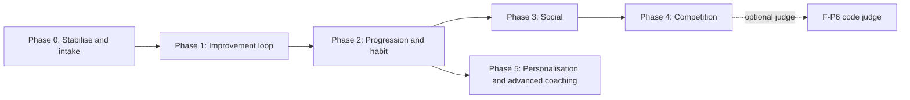
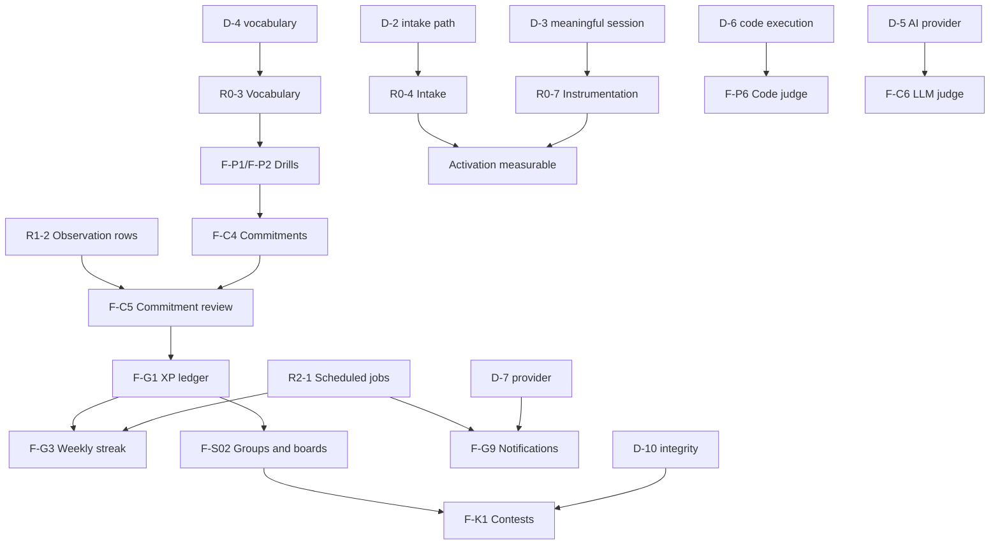

# Roadmap

Status: **proposal for founder and team review. Nothing here is scheduled, committed or approved.** Written 2026-11-03 in `Dojo-main` (branch `test/local-main-e2e`, base `origin/main` `56af7a4`). Companions: [`PRODUCT_STRATEGY.md`](PRODUCT_STRATEGY.md) (why and what), [`FUTURE_ARCHITECTURE.md`](FUTURE_ARCHITECTURE.md) (how), [`COMPETITIVE_RESEARCH.md`](COMPETITIVE_RESEARCH.md) (evidence and sources).

Tags: **[V]** verified in the repository on 2026-11-03, **[P]** proposed, **[R:Sxx]** external research, **[K]** general knowledge not re-verified, **[H]** hypothesis, **[D]** decision required. Feature IDs (`F-xx`) and decision IDs (`D-n`) are shared across all four documents.

## 1. Executive summary

**Sequence.** Make the existing differentiator reachable and measurable first (Phase 0), turn it into a repeatable loop (Phase 1), then add habit and progression (Phase 2), then social (Phase 3), then competition (Phase 4), then deeper AI personalisation (Phase 5). Each phase can end the project's roadmap usefully; later phases are options, not promises.

**Smallest compelling version.** "Improvement Loop v1": an intake path a normal developer can finish, a sample first run, a few rubric-aligned drills, a practice commitment with an honest before-and-after review, a skill map, and instrumentation. About Phases 0 and 1.

**Deliberately not first:** a code-judging practice platform, contests, hackathons, leagues, virtual currency, global rankings. The code-contest ecosystem is crowded and costly [R:S01, S04, S09, S12] and Dojo's edge is measuring improvement on **real work**.

**Recommended next milestone: M1 "Make the loop real"** (section 6).

## 2. What already exists [V]

Accounts, saved workspace, session intake (repo-logger digests only), five-skill rules-based assessment with quoted evidence, history and comparison, PDF reports, and a coaching-first dashboard (Focus next, performance with basis, skill overview, progress, recent sessions, four real-account states) with tests (343 unit, 51 Playwright specs). The dashboard and the development frontend mode are **in the working tree and not yet merged**. See `PRODUCT_STRATEGY.md` section 2.

## 3. Prioritisation method and assumptions

There is no usage data, so numeric RICE scores would be invented. This roadmap uses **qualitative impact and effort with an explicit confidence label**, and says why.

| Dimension      | Scale                                 | How judged                                                                                                                                                                                                                                            |
| -------------- | ------------------------------------- | ----------------------------------------------------------------------------------------------------------------------------------------------------------------------------------------------------------------------------------------------------- |
| **Impact**     | High, Medium, Low                     | Effect on the improvement loop: reaching first value, completing the loop, returning. High means the loop does not work without it.                                                                                                                   |
| **Confidence** | Low, Medium                           | How sure we are that the impact is real. **No item is rated High**: nothing is validated with users yet. Medium needs repository evidence or first-party research.                                                                                    |
| **Effort**     | S, M, L, XL, separately for FE and BE | Relative size for a team of **two developers working with coding agents**. Rough order of magnitude only: S is days, M one to two weeks, L several weeks, XL more than a quarter. These are judgments **[H]**, not estimates anyone has committed to. |

**Assumptions** (each can be wrong): (1) the first audience is AI-agent developers (D-1); (2) the team stays at two developers; (3) the hosting and database stay as they are; (4) authored content (drills) is created by the team, not generated unreviewed; (5) no AI provider is approved yet (D-5); (6) the Supabase project, auth and PostgreSQL arrangement continue.

**Ordering rule.** Order by dependency first, then impact over effort, then by which items **reduce the biggest unknowns** earliest. Items whose success cannot be measured yet come after the instrumentation that measures them.

## 4. Phases at a glance

| Phase | Goal                                                                                                                                   | Exit criteria (all must hold)                                                                                                                                                                                                      | Gate decisions      |
| ----- | -------------------------------------------------------------------------------------------------------------------------------------- | ---------------------------------------------------------------------------------------------------------------------------------------------------------------------------------------------------------------------------------- | ------------------- |
| **0** | Stabilise and document what exists; remove the biggest barrier to first value; add measurement.                                        | Current work merged through the normal gates; docs match the code; a new developer can reach a first Focus without installing anything (sample) or with one documented step (own data); rate limits in place; activation measured. | D-2, D-3, D-4, D-14 |
| **1** | Make the improvement loop real: drills, commitments, a skill map.                                                                      | A user can complete one drill and one commitment, and later see a reviewed outcome with its sample size; navigation shows Practice and Coach.                                                                                      | D-1, D-9            |
| **2** | Habit and progression: effort ledger, weekly goal and streak that rests, achievements, comeback, opt-in notifications, learning paths. | XP and streaks derive from events and can be rebuilt; no punitive reset; notifications opt-in with one-tap off; at least one complete path.                                                                                        | D-7, D-12, D-13     |
| **3** | Social accountability without gameable ranking: friends, private groups, effort-based boards.                                          | Every social feature is opt-in and one tap to leave; the metric is stated on each board; privacy review passed.                                                                                                                    | D-8, D-10           |
| **4** | Competition: community challenges, timed workflow contests, hackathons; optional code judge.                                           | Integrity design approved; first contest unrated; standings immutable once finalised.                                                                                                                                              | D-6, D-10           |
| **5** | Personalisation and advanced coaching: adaptive paths, LLM-assisted explanation or judging, identity features.                         | Consent model approved; every AI-assisted output labelled; the rules engine remains the scored source of truth.                                                                                                                    | D-5                 |

## 5. Features by phase

Columns: **FE** and **BE** are relative effort (S, M, L, XL). **Scope** is **MVP** (in Improvement Loop v1), **Next** or **Later**. Success metrics use the definitions in `PRODUCT_STRATEGY.md` section 8 and **have no targets**, because no baseline exists.

### Phase 0: Stabilise, document and remove the first-value barrier

| ID    | Feature                                                                                                            | User problem                                                 | Product value                                     | Depends on           | FE  | BE  | Risks                                               | Success metric                               | Scope |
| ----- | ------------------------------------------------------------------------------------------------------------------ | ------------------------------------------------------------ | ------------------------------------------------- | -------------------- | --- | --- | --------------------------------------------------- | -------------------------------------------- | ----- |
| R0-1  | Merge current dashboard, shell, dev mode and tests through normal review and gates                                 | Work exists only in a working tree                           | A shared, reviewed base                           | Review               | S   | S   | Merge conflicts with the other developer's branches | Merged with CI green                         | MVP   |
| R0-2  | Sync `README.md`, `docs/STATUS.md`, `docs/HANDOFF.md` with reality; run `template-setup` (project name, site name) | Docs say "not built"; package is `template-web` [V]          | Trustworthy onboarding for contributors           | D on naming          | S   | S   | Template-setup touches many files                   | A reader's first claims match the code       | MVP   |
| R0-3  | Choose one skill vocabulary and align the landing page and product                                                 | Six skills on the landing page, five in the rubric [V]       | Consistent promise and a stable path structure    | D-4                  | S   | S   | Re-adapting the generated landing page              | One vocabulary everywhere                    | MVP   |
| R0-4  | **Intake path** (F-I1): logger installer, raw-transcript import, or both                                           | Digest-only intake means most developers cannot try Dojo [V] | The largest activation unlock                     | D-2; parser design   | M   | L   | Privacy of transcripts; format drift between agents | Time to first value; real-data activation    | MVP   |
| R0-5  | **Sample first run** (F-I2): full Focus on clearly labelled sample data                                            | A visitor cannot see value before supplying data             | First value in minutes; shows what uploading buys | Fixtures (exist [V]) | M   | S   | Mistaking sample for real; misleading claims        | Sample activation, then real-data conversion | MVP   |
| R0-6  | Rate limiting and basic abuse controls on write paths                                                              | None exists [V]                                              | Protects the app before it gets traffic           | None                 | S   | M   | Blocking real users                                 | No uncontrolled write paths                  | MVP   |
| R0-7  | Instrumentation: activation, time to first value, meaningful-session event                                         | No baseline for anything                                     | Makes every later decision measurable             | D-3                  | S   | M   | Collecting personal text in events                  | Metrics defined and reported                 | MVP   |
| R0-8  | Auth-backed e2e in CI (dedicated test Supabase) or a documented local gate                                         | CI skips the core flows [V]                                  | Regression safety                                 | A test project       | S   | M   | Secrets handling; flakiness                         | Core flows run in CI                         | Next  |
| R0-9  | Privacy and retention policy, consent copy, logs policy                                                            | Redaction misses names and paths [V]                         | Safe to invite external users                     | D-13                 | S   | M   | Legal review needed                                 | Policy published and enforced                | MVP   |
| R0-10 | Decide the fate of dev frontend mode                                                                               | It is documented as temporary [V]                            | Avoids a permanent half-feature                   | D-14                 | S   | S   | Prototype pages mistaken for production             | Decision recorded                            | Next  |

### Phase 1: The improvement loop

| ID   | Feature                                                                    | User problem                                                  | Product value                                      | Depends on                       | FE  | BE  | Risks                                                                | Success metric                                     | Scope |
| ---- | -------------------------------------------------------------------------- | ------------------------------------------------------------- | -------------------------------------------------- | -------------------------------- | --- | --- | -------------------------------------------------------------------- | -------------------------------------------------- | ----- |
| F-P1 | **Rewrite drills** scored by the rules engine's own criteria               | Knowing a weakness is not the same as fixing it               | Turns the Focus into practice                      | Drill contract; engine reuse [V] | M   | M   | Gaming the scorer; transfer to real work **[H]**                     | Drill completion; drill-to-commitment rate         | MVP   |
| F-P2 | **Review drills** (what verification to ask for)                           | Verifying agent output is a top gap area (a rubric skill [V]) | Covers a second skill with a different format      | Authored content                 | M   | M   | Content quality; scoring free text                                   | Same as above                                      | MVP   |
| F-P8 | Worked examples and explanations for every drill                           | Feedback without a model answer is hard to use                | Learning value; reduces confusion                  | Authoring                        | S   | S   | Authoring cost                                                       | Helpful-rating on explanations                     | MVP   |
| F-C7 | Drill recommendation from assessed weaknesses (criterion to drill mapping) | Users do not know what to practise                            | Connects assessment to action                      | F-P1, F-P2                       | S   | S   | Mapping gaps for some criteria                                       | Share of Focus blocks followed by a drill (7 days) | MVP   |
| F-C4 | **Practice commitments**                                                   | Practice does not reach real work                             | The bridge to real behaviour                       | New persistence                  | M   | M   | Over-promising; weak baselines                                       | Commitments set                                    | MVP   |
| F-C5 | **Commitment review** in the next assessment, with sample size and basis   | No proof that anything changed                                | The honest improvement signal; core differentiator | F-C4; per-criterion observations | M   | L   | False negatives on small samples; relational storage of observations | Commitments reviewed; keep rate with sample sizes  | MVP   |
| F-L1 | **Skill map** (five skills, level, drills done)                            | No overview of progress per skill                             | A home for drills and later paths                  | Assessments [V]                  | M   | S   | Duplicating the dashboard skill overview                             | Return visits that open a skill                    | MVP   |
| R1-1 | Navigation update: Coach and Practice areas, bottom tab bar on mobile      | One-level navigation will not hold new areas                  | Familiar IA (Jakob's Law)                          | D-9                              | M   | S   | Advertising empty areas                                              | Task success in navigation tests                   | MVP   |
| R1-2 | Per-criterion observation rows (relational) for trends                     | Habit trends need queryable history; today it is JSON [V]     | Enables commitment review and per-habit charts     | New persistence                  | S   | M   | Backfilling past assessments                                         | Trends available for new assessments               | MVP   |
| R1-3 | Drill authoring pipeline and review checklist                              | Content is the main ongoing cost                              | Sustainable quality                                | None                             | S   | S   | Bottleneck on the team                                               | Time to author a drill                             | MVP   |

### Phase 2: Progression and habit

| ID   | Feature                                                               | User problem                                   | Product value                                   | Depends on                | FE  | BE  | Risks                                                             | Success metric                                  | Scope |
| ---- | --------------------------------------------------------------------- | ---------------------------------------------- | ----------------------------------------------- | ------------------------- | --- | --- | ----------------------------------------------------------------- | ----------------------------------------------- | ----- |
| F-G1 | **XP ledger** (effort), separate from proficiency                     | Effort is invisible                            | Recognition that never reads as skill           | Events from Phase 1       | M   | M   | Farming; confusing XP with skill                                  | XP only for completed, feedback-seen work       | Next  |
| F-G4 | User-chosen **weekly goal**                                           | No personal commitment structure               | Supports autonomy [R:S27]                       | Onboarding step           | S   | S   | Wrong defaults                                                    | Goal attainment                                 | Next  |
| F-G3 | **Weekly streak with built-in rest**                                  | Consistency without punishment                 | Habit support without loss framing              | F-G1, meaningful event    | S   | M   | Trivial actions keeping it alive; weekly cadence untested **[H]** | Share of streak weeks with a meaningful session | Next  |
| F-G6 | Achievements for meaningful milestones                                | No recognition of real progress                | Quiet, honest celebration                       | Event model               | M   | M   | Badge hunting                                                     | Achievements only for meaningful milestones     | Next  |
| F-G8 | Comeback flow                                                         | Returning users feel behind                    | Re-engagement without guilt                     | Streak and goal state     | S   | S   | Over-prompting                                                    | Return-and-complete rate vs no-prompt group     | Next  |
| F-G9 | **Opt-in notifications** (weekly summary, commitment reminder)        | Forgetting a commitment                        | A prompt at a chosen time [R:S26]               | D-7; jobs                 | S   | L   | Fatigue; deliverability; consent                                  | Opt-in rate; action rate (not open rate)        | Next  |
| R2-1 | Scheduled jobs (weekly rollup, summary)                               | No job mechanism exists [V]                    | Prerequisite for streaks and notifications      | D-12                      | S   | M   | Hosting limits not researched **[K]**                             | Jobs run reliably and idempotently              | Next  |
| R2-2 | Profile fields (goal, timezone, visibility) on a proper profile model | `User` is a template model with few fields [V] | Foundation for goals, streaks and visibility    | Migration decision        | S   | M   | Moving `User` out of `example.prisma`                             | Profile data stored                             | Next  |
| F-L2 | **Learning paths**                                                    | Drills are an unordered pile                   | A bounded route with a visible end [R:S13, S14] | Content; skill vocabulary | M   | M   | Content volume; ordering assumptions                              | Path progression                                | Next  |
| F-L3 | Prerequisite mapping                                                  | Steps taken in the wrong order                 | Smoother progression                            | F-L2                      | S   | S   | Authoring burden                                                  | Completion without backtracking                 | Next  |
| F-L4 | Revision schedule (fixed intervals first)                             | Habits fade                                    | Spacing effect [R:S22, S23]                     | Drill history             | S   | M   | Review fatigue                                                    | Revision completion; later assessment change    | Next  |
| F-L5 | Milestones and completion                                             | No sense of finishing                          | Closure and recognition                         | F-L2                      | S   | S   | None notable                                                      | Path completion                                 | Next  |
| F-P3 | Plan-first drills                                                     | Planning before coding is a rubric skill       | Covers a third skill                            | Content                   | M   | M   | Content quality                                                   | Drill completion                                | Next  |
| F-P5 | Daily or weekly recommended drill                                     | Choosing what to do                            | Low-effort next action                          | F-C7                      | S   | S   | Repetition                                                        | Recommended-drill start rate                    | Next  |
| F-P7 | Themed challenge sets                                                 | Variety                                        | Content breadth                                 | Authoring                 | M   | S   | Authoring cost                                                    | Set completion                                  | Next  |

### Phase 3: Social, without a gameable ranking

| ID    | Feature                                                    | User problem                      | Product value                                  | Depends on               | FE  | BE  | Risks                     | Success metric                                    | Scope  |
| ----- | ---------------------------------------------------------- | --------------------------------- | ---------------------------------------------- | ------------------------ | --- | --- | ------------------------- | ------------------------------------------------- | ------ |
| F-S01 | Friends and optional shared activity                       | Learning alone                    | Relatedness [R:S27]; accountability [R:S19]    | Profile; D-8             | M   | M   | Pressure; leaking details | Meaningful sessions among connected users         | Next   |
| F-S02 | **Private groups** with effort-based boards, metric stated | No safe way to compare with peers | Smallest social unit that works with few users | F-G1; snapshot jobs      | M   | L   | Exclusion; gaming effort  | Group-active members who complete meaningful work | Next   |
| F-D1  | Public profile (opt-in, off by default)                    | No developer identity             | Shareable record                               | Privacy review; D-8      | M   | M   | Privacy; quote exposure   | Profiles published by choice                      | Later  |
| F-S03 | Skill-specific rankings from practice                      | Wanting to see where one stands   | Familiar pattern                               | **D-10**; robust scoring | M   | L   | Gaming; discouragement    | Not set until D-10                                | Later  |
| F-S04 | Weekly leagues                                             | Competitive motivation            | Engagement for some users [R:S18]              | Critical mass; D-10      | M   | L   | Loss framing; needs users | Opt-in rate; no demotion pressure                 | Option |

### Phase 4: Competition

| ID   | Feature                                                                           | User problem                                     | Product value                                  | Depends on                             | FE  | BE  | Risks                                                          | Success metric                                | Scope  |
| ---- | --------------------------------------------------------------------------------- | ------------------------------------------------ | ---------------------------------------------- | -------------------------------------- | --- | --- | -------------------------------------------------------------- | --------------------------------------------- | ------ |
| F-K5 | Community challenges and an event calendar                                        | Nothing to do together                           | Lightweight shared goals                       | Groups                                 | M   | M   | Low turnout                                                    | Participation                                 | Later  |
| F-K1 | **Timed workflow contests** (same brief, judged on workflow evidence and outcome) | No place to test workflow skill under constraint | A format no researched platform offers **[H]** | Integrity design (D-10); metric design | L   | XL  | Cheating; scorer tuning; ranking a gameable score              | Participation; post-event meaningful sessions | Later  |
| F-K4 | Hackathons with team formation                                                    | Team events need coordination                    | Community and showcase [R:S09, S12]            | Teams; contest machinery               | L   | XL  | Operational load; moderation                                   | Teams completing a submission                 | Later  |
| F-K2 | Virtual contests                                                                  | Missing a live event                             | Replayability [R:S01]                          | F-K1                                   | M   | L   | Fairness vs live standings                                     | Virtual participation                         | Later  |
| F-K3 | Ratings and rating history                                                        | Wanting a standing across events                 | Long-term identity [R:S02, S03, S06]           | Robust metric; several contests        | M   | L   | Rating inflation; discouragement                               | Not set until the metric is trusted           | Later  |
| F-P6 | **Code judge** (DSA, SQL) with submissions                                        | Familiar coding practice                         | Matches established platforms [R:S10]          | **D-6**; sandbox service               | XL  | XL  | Sandbox security; cost; crowded field; moves Dojo off its edge | Decided by D-6, not by this roadmap           | Option |

### Phase 5: Personalisation and advanced coaching

| ID   | Feature                                                              | User problem                       | Product value                                       | Depends on                    | FE  | BE  | Risks                                                        | Success metric                          | Scope |
| ---- | -------------------------------------------------------------------- | ---------------------------------- | --------------------------------------------------- | ----------------------------- | --- | --- | ------------------------------------------------------------ | --------------------------------------- | ----- |
| F-C6 | LLM judge for softer qualities and richer explanations               | Rules read wording, not intent [V] | Deeper, more nuanced coaching                       | **D-5**; consent; cost policy | M   | L   | Privacy; cost; confident-sounding errors; replacing evidence | Rules and LLM agreement; user trust     | Later |
| R5-1 | Adaptive paths and personalised curricula                            | One path does not fit everyone     | Fit to evidence and goals [R:S21, S25 for the idea] | Phases 1 to 2 data            | L   | L   | Overfitting on little data                                   | Path completion vs fixed path           | Later |
| F-G5 | Weekly quests or missions                                            | Goals feel thin                    | Variety                                             | F-G1                          | M   | M   | Compulsion if misdesigned                                    | Meaningful, not merely higher, activity | Later |
| F-P4 | Debugging, code review and refactoring exercises in an agent context | Broader practice                   | Extends beyond prompts                              | Richer exercise formats       | L   | L   | Content cost                                                 | Completion                              | Later |
| F-D2 | Verified, shareable achievements                                     | Showing progress outside Dojo      | Identity and word of mouth                          | D-8                           | M   | M   | Over-claiming; privacy                                       | Shares by choice                        | Later |
| F-D3 | Progression timeline and portfolio integration                       | A narrative of growth              | Long-term retention                                 | Identity decisions            | M   | M   | Privacy                                                      | Timeline views by owners                | Later |

**Not scheduled, on purpose.** F-G2 (levels derived from XP) is optional and Later; F-G7 (virtual currency, purchasable protections, reward chests) is **not proposed** because nothing in the research or the product justifies it and it invites the manipulative patterns listed in `COMPETITIVE_RESEARCH.md`. F-C1 to F-C3 already exist [V].

## 6. Recommended next milestone: M1, "Make the loop real"

**Scope** (Phase 0, then the first half of Phase 1): R0-1 to R0-7 and R0-9; F-P1, F-P2, F-P8, F-C7; F-C4 and F-C5 with R1-2; F-L1; R1-1 as the minimum navigation change.

**Before starting [D]:** D-1 (audience), D-2 (intake path), D-3 (meaningful session), D-4 (vocabulary), D-9 (labels).

**Exit criteria:** a new developer, unaided, reaches a first evidence-backed Focus (sample or own data), completes one drill and one commitment, and later sees a reviewed outcome with its sample size; the team can report time to first value and the share who reach each step; every gate passes in CI.

**Explicitly not in M1:** XP, streaks, notifications, paths, groups, contests, hackathons, a code judge, an AI provider.

**Why this first:** it tests the hardest unknowns (can people get data in, do drills transfer to real work, does a commitment review feel honest) before spending on mechanics that only amplify a loop that may not work yet.

## 7. Impact and effort summary

| Item                                       | Impact | Confidence | FE  | BE  | Note                                             |
| ------------------------------------------ | ------ | ---------- | --- | --- | ------------------------------------------------ |
| Intake path (R0-4)                         | High   | Medium     | M   | L   | Repository shows intake only accepts digests [V] |
| Sample first run (R0-5)                    | High   | Medium     | M   | S   | Cheap and tests whether value is clear           |
| Instrumentation (R0-7)                     | High   | Medium     | S   | M   | Everything else depends on measuring             |
| Drills (F-P1, F-P2)                        | High   | Low        | M   | M   | Transfer to real work is a hypothesis            |
| Commitments and review (F-C4, F-C5)        | High   | Low        | M   | L   | Core differentiator; small-sample honesty needed |
| Skill map (F-L1)                           | Medium | Medium     | M   | S   | Reuses existing proficiency levels               |
| XP, goal, weekly streak (F-G1, F-G4, F-G3) | Medium | Low        | M   | M   | Only after the loop works                        |
| Notifications (F-G9)                       | Medium | Low        | S   | L   | Needs jobs and a provider                        |
| Paths (F-L2)                               | Medium | Low        | M   | M   | Content-heavy                                    |
| Private groups (F-S02)                     | Medium | Low        | M   | L   | Needs users to matter                            |
| Contests (F-K1)                            | Medium | Low        | L   | XL  | Integrity design is a prerequisite               |
| Code judge (F-P6)                          | Low\*  | Low        | XL  | XL  | \*Low for Dojo's differentiation, high cost      |
| LLM judge (F-C6)                           | Medium | Low        | M   | L   | Needs consent and a provider decision            |

## 8. Dependencies

## 9. Alternatives considered

| Option                                          | What it would do                                          | Why not first                                                                                                                                          |
| ----------------------------------------------- | --------------------------------------------------------- | ------------------------------------------------------------------------------------------------------------------------------------------------------ |
| **A. Coach-first loop (recommended)**           | Intake, drills, commitments, then habit                   | Builds on the existing differentiator; smallest backend change; tests the riskiest assumptions first.                                                  |
| B. Code-practice-first (a LeetCode-style site)  | Problem bank, judge, submissions, difficulty and contests | Largest cost (sandbox, content, anti-cheat); head-on with established products [R:S01, S04, S10, S12]; leaves Dojo's differentiator as a side feature. |
| C. Social-first (friends, leagues, rankings)    | Leaderboards and leagues early to drive engagement        | Needs a user base to mean anything; rankings on a gameable rubric invite cheating; risks coercive patterns [R:S29].                                    |
| D. Gamification-first (XP, streaks, badges now) | Quick engagement mechanics on today's product             | Rewards activity before a loop exists to reward; risks hollow engagement. Duolingo's mechanics sit on a core lesson loop [R:S16 to S19].               |

## 10. Risks and unresolved questions

- **Capacity.** Two developers; each phase is sized to fit, but effort labels are judgments **[H]**.
- **Content cost** may dominate Phases 1 to 2; the authoring pipeline (R1-3) is an early investment.
- **Rules-based scoring** limits what drills can credibly assess; the LLM option (F-C6) is gated by D-5.
- **Audience size is unknown.** Social and competition features need users; if adoption is slow, Phases 3 and 4 should be deferred, not built.
- **Open:** the audience (D-1); whether to support interview-prep users at all; naming (D-9); whether the repository logger is distributed to external users and under what licence (D-2); retention period (D-13); named backend and frontend ownership (D-11).

## 11. Decisions requiring founder or team approval

D-1 audience. D-2 intake path and logger distribution. D-3 meaningful-session definition. D-4 skill vocabulary. D-5 AI provider and consent. D-6 code execution. D-7 notification provider. D-8 public profile and sharing defaults. D-9 navigation labels. D-10 rankings before robust scoring. D-11 named ownership. D-12 scheduled jobs. D-13 retention period. D-14 development frontend mode. Full wording: `PRODUCT_STRATEGY.md` section 13 and `FUTURE_ARCHITECTURE.md` section 12.

This is a planning document. It does not schedule work, change code, schema or authentication, and it authorises no implementation. Wait for approval before building.
