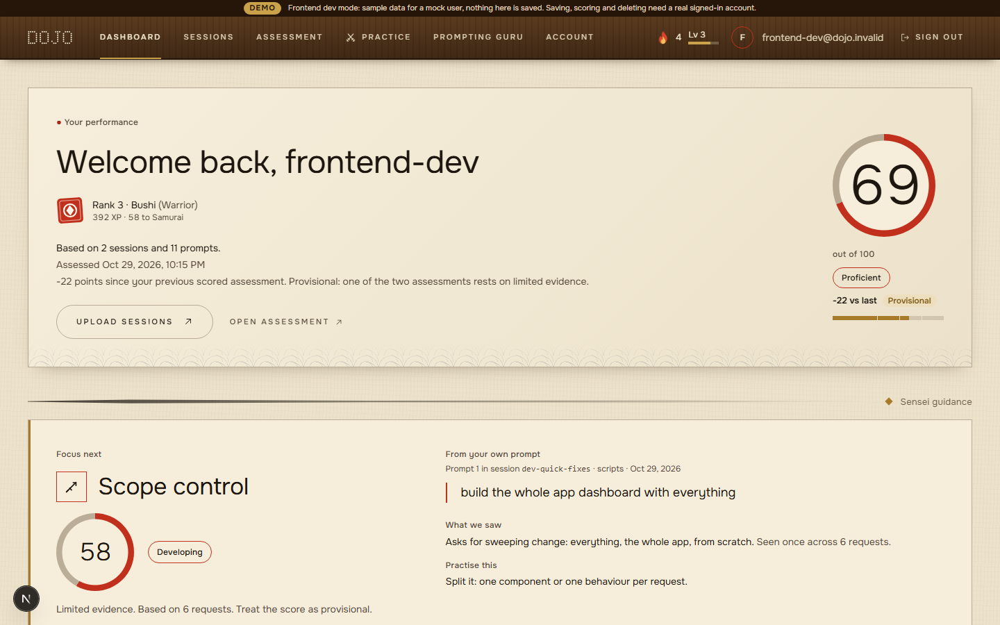
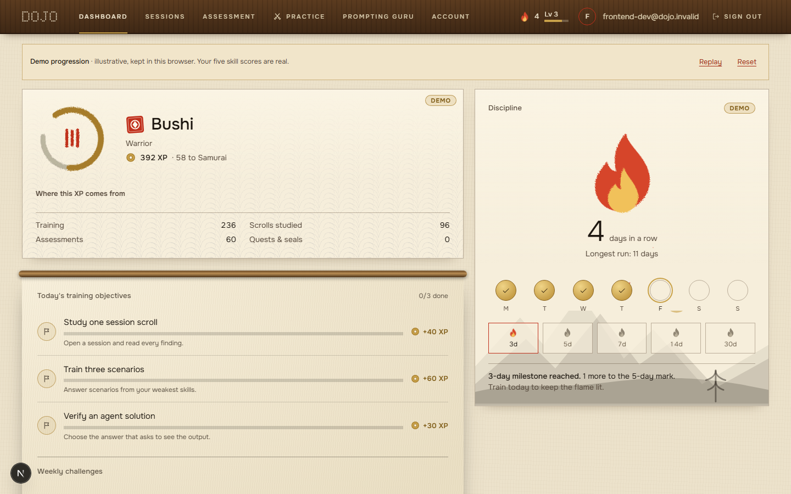
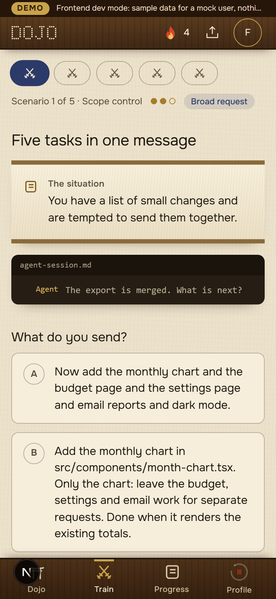
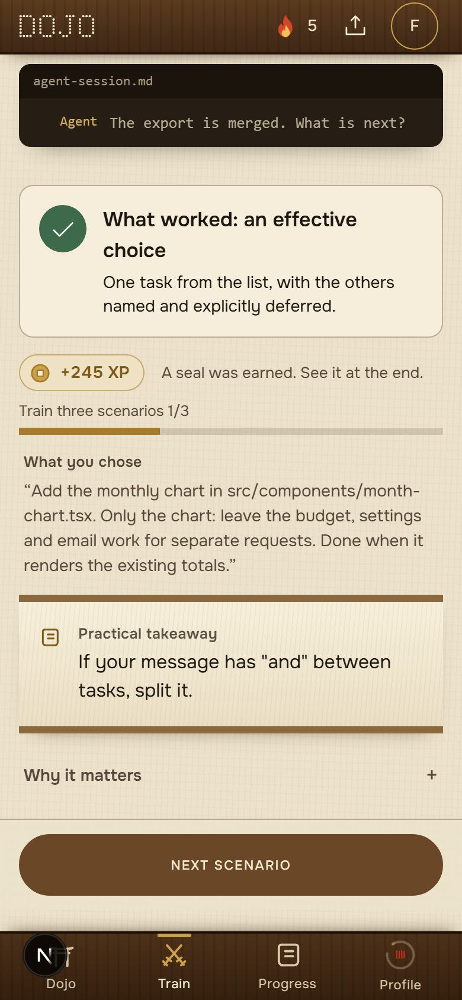
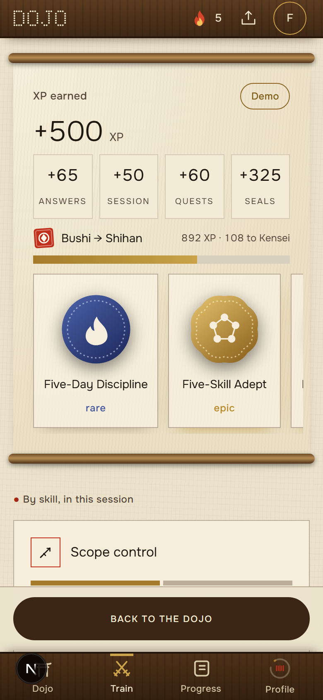
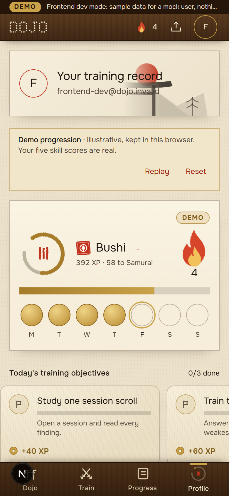
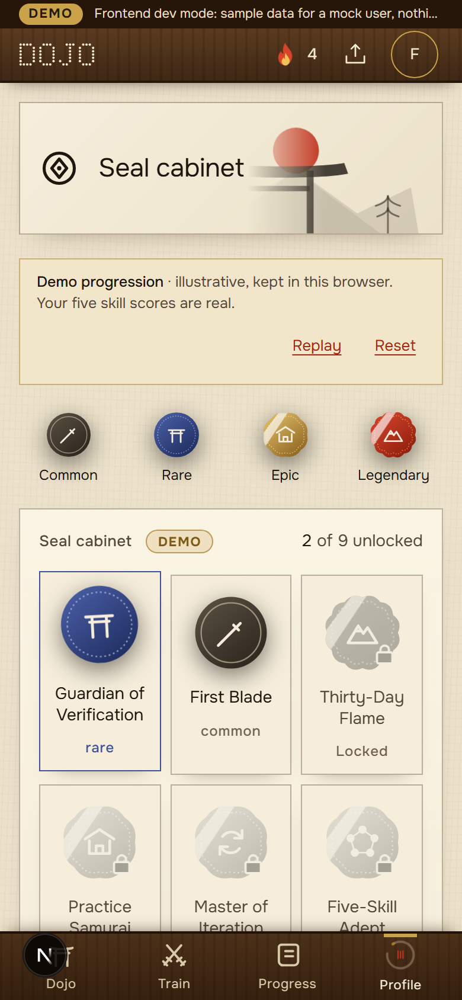
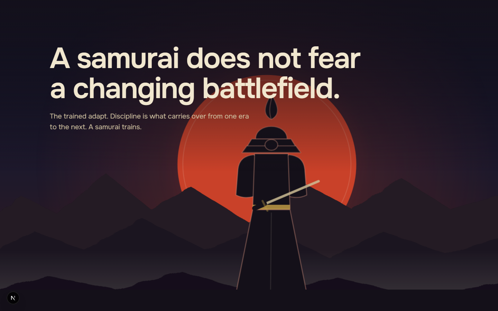

# Dojo: submission

**Train how you work with AI coding agents.**

Dojo is a web app that coaches developers on how they work with AI coding agents (Claude Code, Codex). The coaching comes from the developer's own agent sessions, not from generic lessons.

## The problem

Developers now hand real work to coding agents, but almost nobody gets feedback on _how_ they do it: how they scope a task, what context they give, when they step in, how they check the result. Prompt tutorials cannot see any of that.

## The differentiator

**Evidence-based analysis of real coding-agent sessions, turned into personal practice.**

- Upload your own session logs (prompts and final answers; secrets redacted before anything is stored).
- Five skills are scored against what you actually wrote: prompt clarity, planning, verification, iteration and scope control.
- Every finding points to a quoted line in your own conversation.
- The weakest skill becomes your **Focus next**, with practice built from it.
- Scores come from deterministic rules. AI is an optional layer on top, and it is always labelled.

## The user journey

1. **Landing** (`/`): the existing 3D hero, then the Red Moon Era story.
2. **Try the sample** (`/sample`): a full journey on demonstration data, no account, nothing written to any account.
3. **Sign up and upload** (`/sessions`): session logs are parsed and redacted in the browser tab; the redacted conversations and metrics are saved to the account.
4. **Assessment** (`/assessment`): five skill scores, an overall score, and evidence for each. The report says how it was scored (AI, rules, or rules as a fallback).
5. **Evidence viewer** (`/assessment/session`): the whole conversation with every finding marked in place; review marks and notes.
6. **Dashboard** (`/dashboard`): your real performance and **Focus next** lead. Rank, streak, XP, quests and seals follow, clearly marked as a demonstration.
7. **Practice**: scenario practice (`/practice/session`), a rewrite drill, and **Prompting Guru** (`/prompting-guru`), a challenge library with answer evaluation.

## Key features

| Feature                      | Notes                                                                                                                            |
| ---------------------------- | -------------------------------------------------------------------------------------------------------------------------------- |
| Session upload and redaction | Claude Code and Codex logs; raw files are never uploaded.                                                                        |
| Five-skill assessment        | Rules engine (`rules-1.0`) is the baseline. PDF report export.                                                                   |
| AI assessment (optional)     | Off unless configured. Falls back to the rules engine on any failure.                                                            |
| AI insights (optional)       | Session analysis, assessment explanation, attempt feedback. Clearly labelled, never changes official scores.                     |
| Evidence viewer              | Findings anchored to the exact quoted line; notes and review marks stored in the browser.                                        |
| Practice                     | Scenario practice and a rewrite drill scored by the same rules; Prompting Guru challenges.                                       |
| Sample mode                  | Public, signed-out, labelled as demonstration data, writes nothing to any account.                                               |
| Demo progression             | Rank, streak, XP, quests, seals and a heatmap. Stored only in the browser, labelled **Demo**, never part of an assessment score. |
| Mobile app frame             | Bottom tab bar, sticky actions, swipe shelves at phone width.                                                                    |

## AI integration

AI provider code lives in `src/server/ai/` and feature code in `src/features/ai-insights/`, `src/features/assessment/llm/` and `src/features/practice/`.

- **Off by default.** Nothing calls a provider unless `AI_ENABLED="true"` and the chosen provider's key is set. `AI_PROVIDER` selects `openrouter` (default, free-tier model) or `xai`.
- **Rules fallback.** `AI_SCORING="on"` scores assessments and Prompting Guru answers with the model; if the call fails, times out, or returns something that does not validate, the deterministic rules engine scores instead and the result is marked `rules_fallback`.
- **Honest labelling.** The assessment page reads how a stored result was scored (`ai`, `rules`, `rules_fallback`) and says so. AI insight panels are shown only for real signed-in users when AI is configured and the `ai_insights` flag is on; otherwise they are left out, with no placeholder.
- **No invented output.** Model answers are validated against schemas before they are shown. Failures are reported, never replaced with fabricated text.
- **Cost tracking.** Each call is recorded in `ai_usage` and priced at write time. Models must be registered in `src/server/lib/ai-usage/models.ts`.

## Technology and architecture

- Next.js 16 (App Router, Turbopack) and React 19 with the React Compiler; Tailwind CSS v4; next-intl.
- PostgreSQL through Prisma (the only data path); Supabase Auth for accounts, with row-level security on every table.
- Sentry for errors, Pino for logs, PostHog for analytics, Vercel for hosting.
- Landing hero: a Three.js scene (ThreeUI package). The Red Moon story and every other screen is native React with original SVG artwork.
- Architecture notes: [`ARCHITECTURE.md`](ARCHITECTURE.md). Rules: [`rules/`](rules/).

## Setup

```bash
pnpm install
cp .env.example .env.local        # fill in the values below
pnpm prisma:generate
pnpm dev                          # http://localhost:3000
```

Minimum for a real run: `DATABASE_URL`, Supabase URL and keys, `NEXT_PUBLIC_APP_URL`. Every variable is documented in `.env.example` and [`ENVIRONMENT.md`](ENVIRONMENT.md).

To try the interface without Supabase, start with `DOJO_DEV_FRONTEND_MODE=true pnpm dev` (see [`FRONTEND_DEV_MODE.md`](FRONTEND_DEV_MODE.md)). This mode only works in development: `next build` and `next start` run with `NODE_ENV=production`, which switches it off whatever the environment says.

## Deployment

The repository is set up for Vercel with GitHub Actions (see [`CI_CD_SETUP.md`](CI_CD_SETUP.md)). Pushes to `main` deploy to production; other branches get preview deployments; migrations run through `deploy-migrations.yml`.

Production checklist:

1. `DATABASE_URL` (pooled, port 6543) set in Vercel; `PRODUCTION_DATABASE_URL` (session pooler, 5432) set as a GitHub environment secret for migrations.
2. Supabase project URL and keys set; auth callback and site URLs include the production domain.
3. `NEXT_PUBLIC_APP_URL` set to the real domain.
4. `DOJO_DEV_FRONTEND_MODE` unset (it cannot take effect in production regardless).
5. Optional AI: `AI_ENABLED="true"`, `AI_PROVIDER`, and the provider key. Leave unset to run on rules alone.

**Deployment URL:** none has been recorded. This repository does not link a deployed site because none has been confirmed.

## Demo instructions

- **No account:** open `/sample` and follow Run the assessment, then the evidence, Focus next and the drill. Everything is labelled demonstration data.
- **With an account:** sign up, upload logs from `.claude-logs/` or any Claude Code / Codex session digest, run the assessment, open Focus next.
- **Local interface demo:** `DOJO_DEV_FRONTEND_MODE=true pnpm dev` shows a mock user with fixture data.

## Screenshots

Captured from the running app.

|                                                                                                           |                                                                                                         |
| --------------------------------------------------------------------------------------------------------- | ------------------------------------------------------------------------------------------------------- |
|  |  |
| Dashboard: real performance and Focus next.                                                               | Demo progression: rank, streak, quests.                                                                 |
|                                |                              |
| Practice on a phone.                                                                                      | Coaching feedback.                                                                                      |
|                             |                                         |
| Session completion.                                                                                       | Profile.                                                                                                |
|                              |                          |
| Achievements.                                                                                             | The Red Moon Era story below the hero.                                                                  |

## What is not claimed

No user counts, customer names, employment statistics or performance numbers appear in the product or here. Rank, streak, XP and seals are an illustration of progression, kept in the browser, and are not part of any assessment.
